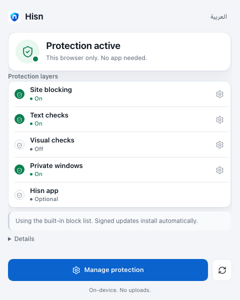
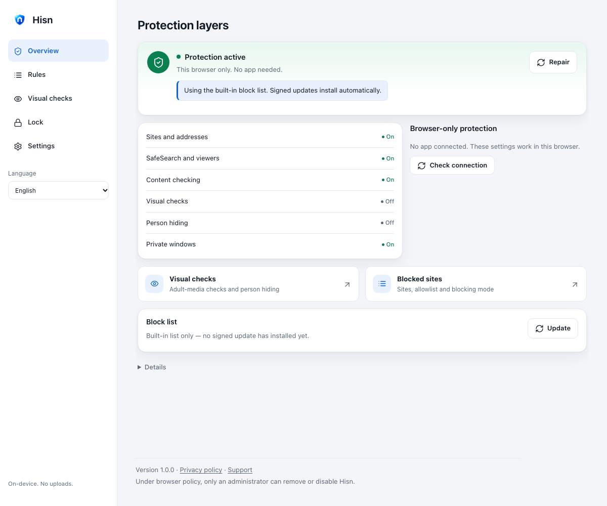

# Hisn · حصن

[](https://github.com/hamzabinjehad/AdultContentBlocker/actions/workflows/ci.yml)

**Arabic-aware adult-content protection for the browser, Mac, iPhone, iPad and Android.**
Matching runs on the device, nothing about your browsing is reported, and every
layer says plainly what it does not cover.

Hisn is built to work *under* each platform's own controls (Screen Time, Family
Sharing, MDM, a separate admin account), not to replace them. The platform gives
you the lock; Hisn adds the coverage those built-in filters miss. Read
[Positioning](docs/POSITIONING.md) for why it exists, and the
[Threat model](docs/THREAT_MODEL.md) before changing anything.

## Latest

- **Blocklist v6** — the first signed list generation is published:
  **5,274,046 domains**, 239,885 core and 5,831 terms, verified over HTTPS and
  served with HTTP 200. The bundled seed stays v5; iOS and Android still update
  with an app build.
- **Extension 1.5.0** — **Move your rules**: export the hand lists to a
  versioned file and import one add-only in another browser. A lock keeps new
  allowances and corrections waiting; a file can never remove a block.
- **iPhone & iPad 1.4.0** — a custom Screen Time shield names the saved rule in
  English or Arabic and offers only Close, with no unlock action; the on-demand
  pause, protection hero, daily quiet hours and saved-rule freeze remain.
- **Mac 1.1.10** — a UI/UX pass: one title per page (the window title bar), the
  Overview action above the layer evidence, one Setup card with progress and the
  next step, one statement of the chosen lock mode, and Blocking Rules leading
  with the lists. Design research used REA on Screen Zen 2.0.0. The 1.1.9 guard
  card, layer chips, 1.1.8 pause and protection-authority checks remain.
- **Android 1.1.0** — a first-run welcome, a voluntary pause on Protection and
  today's usage in the daily-limit editor sit on the 1.0.0 protection lock,
  removal guard, managed lockdown and layer watchdog. The signed direct APK is
  published on GitHub Releases; the Play AAB is not uploaded.

These are development candidates. No store listing or physical-device
acceptance is claimed; the Android 1.1.0 direct APK is published on GitHub and
the Play AAB is not uploaded. The exact state is in
[versions](docs/VERSIONS.md) and [1.0 readiness](docs/1.0_READINESS.md).

### Interface

<p align="center">
  
  
</p>

The extension popup and dashboard lead with one protection status and one-word
layer states. More captures, including Arabic and dark mode, are in the
[UI pass record](design/extension-ui-2026-11-02/README.md).

## Platforms

| Platform | What it does | State | Start here |
| --- | --- | --- | --- |
| Browser extension (Chromium) | Blocks listed domains, checks page text in the page's language, optional local image/video checks, portable hand lists | 1.5.0 | [Using the extension](docs/EXTENSION_USAGE.md) |
| Mac | Content-filter system extension, browser guard, locks, authority checks, accountability partner, root guardian daemon and an on-demand breathing pause | 1.1.10, needs a signed build | [Mac setup](docs/SETUP.md) |
| iPhone & iPad | Six Safari blockers, Safari text extension, Screen Time app limits with a custom bilingual shield, optional family DNS, protection lock for saved rules, an on-demand pause and daily quiet hours | 1.4.0, development | [iOS README](ios/README.md) |
| Android | DNS filtering, selected-app and word restrictions, per-app daily time limits, first-run welcome, voluntary pause, optional image checks, browser-coverage screen, schedules, protection lock that freezes saved rules, opt-in device-owner uninstall guard and managed lockdown, direct-build removal guard, layer watchdog and bundled-list freshness warning | 1.1.0 direct published; Play AAB not uploaded | [Android README](android/README.md) · [1.1 record](docs/ANDROID_1.1.0.md) |
| Network / router | Verified signed DNS rules for administrator import | Tools only | [Network tools](network/README.md) |

Seed **v5** raises the bundled core from 159,768 to **239,885 domains** on every
surface, the largest tier the browser, six Safari blockers and the Android seed
can hold without truncation. The selection rules, the 1,261 domains deferred by
capacity and the licensing boundary are in the
[coverage pass record](docs/COVERAGE_PASS_2026-10-30.md). A signed **lists v6**
generation (5,274,046 domains) is published for the Mac filter and the browser's
list update; the seed remains the offline fallback. The evidence, hashes and the
guard refusal that preceded it are in
[the publication record](docs/LIST_PUBLICATION_2026-11-03.md).

Each platform's start link is in the table; Mac users can also follow the
[Mac user guide](docs/USER_GUIDE.md). Every document is listed in the
[docs index](docs/README.md). The pinned version of every platform, and the honest release state behind it,
is in [versions](docs/VERSIONS.md); the single finish line, including what is
still unproven, is [1.0 readiness](docs/1.0_READINESS.md); per-surface
list coverage is in [coverage](docs/COVERAGE.md). The
[privacy policy](PRIVACY.md) and [support page](SUPPORT.md) are the public
statements to check before a release.

## Protection layers

| Layer | Closes | Defeated by |
|---|---|---|
| Network DNS (administrator setup) | Listed hosts on devices using the resolver | Outside DNS, tunnels, another network, gateway reset |
| Browser extension | Known domains, page text and opt-in readable image/video samples in supported browsers | Another browser, removal/disablement, unreadable media, classification misses |
| Configuration profile | Supported DNS, Private Relay, and browser settings | A tunnel; an administrator removing the profile |
| Content filter (system extension) | Host/application decisions on new Mac flows | Provider loss, established flows, unidentified destinations outside strict mode, recovery/admin changes |
| Accountability partner | Ordinary user loosening an active policy | Guardian authority or recovery; a separate unprotected device |
| Browser guard (in the app) | Warns/closes disconnected browsers and repeatedly confirmed off standard profiles during locks or outside-lock opt-in | Force-quitting Hisn, explicitly trusted unknown apps, unreadable/custom profiles, guest/private windows, admin changes |

These layers address different gaps and need independent checks. A browser
model cannot replace a device/network control, while DNS and socket decisions
cannot classify every encrypted post. No combination guarantees all-content
coverage or prevents a device owner with administrator/recovery access from
undoing protections.

For the app-level layer, [apps to consider blocking](docs/APPS_TO_CONSIDER.md)
is a category-based checklist, not an "adult app" verdict: it explains what
each block costs, why browsers and messaging are high-cost choices, and what
must stay accessible.

Blocking your own sites works the same way everywhere: the extension popup's
**Block** button for the current tab, the Mac menu bar's **Block a site…**, and
iPhone/iPad **My blocked sites** (up to 49 sites through the Screen Time filter).

To make protection hard to delete or switch off, use each platform's own
lock-down: on a Mac, the guardian account split (`setup_guardian.sh`) with the
removal-password profile; on iPhone/iPad, a supervised device with
`profile/make_ios_profile.py` ([guide](docs/IPHONE_SUPERVISED.md)); on Windows,
the browser policy from `profile/make_windows_policy.py` with a standard user
account ([guide](docs/WINDOWS_SETUP.md)). No setup
survives someone who holds the admin, recovery or supervision credentials.
The managed-device route (Android device owner, Apple supervision, a guardian
console and phone-laptop pairing) is planned in
[Guardian mode](docs/GUARDIAN_MODE_PLAN.md).

## Repository layout

```
blocklist/       list pipeline: fetch → merge → sign, keyword layer, seed bundle  (Python)
network/         capability planning + verified DNS-rule publication             (Python)
profile/         .mobileconfig generator: DNS, DoH, Private Relay                (Python)
extension/       Chromium MV3 extension + opt-in local visual engine             (JS)
macos/           the app + content filter                                        (Swift)
ios/             universal iPhone/iPad app, Safari blockers + optional family DNS (Swift)
android/         DNS, selected-app/text and opt-in visual protection preview      (Java)
ipados/          iPad-specific documentation; shares the ios/ target
shared/apple/    portable Apple-platform configuration and protection-state code
seed/            signed starter list + keyword layer, bundled into each client
partner/         the accountability partner's page: key, and signed approvals    (HTML)
docs/            guides, plans, release records and the docs index
.github/         CI on every PR; daily signed rebuild and publish                 (Actions)
```

## Testing

```bash
./test.sh              # python, seed, extension, release, macos, ios
./test.sh python seed  # the suites that run on any OS
./test.sh browser      # the page scanner in headless Chrome (CI always runs it)
./test.sh ios          # mobile unit tests + a locally available iOS simulator
extension/eval/run.sh  # score the evaluation corpus; a blocked benign page fails
cd android && sh test-core.sh   # Android core suite (JDK 17+)
```

`./test.sh` is the same script CI runs. A suite whose toolchain is missing fails
rather than skips: "the tests passed" has to mean they ran. The default run needs
Xcode and an installed iOS Simulator runtime; name suites explicitly for a
narrower run.

Building, signing, the seed bundle, the extension, the Mac app, the native
messaging host and lock lengths are covered in
[development notes](docs/DEVELOPMENT.md). Maintainers releasing a build follow
the [release runbook](docs/RELEASE_RUNBOOK.md) and record results in
[release validation](docs/RELEASE_VALIDATION.md); every change is summarized in
the [changelog](CHANGELOG.md).

## Privacy

See [SECURITY.md](SECURITY.md) for private vulnerability reporting and the limits that are documented product boundaries, not bugs.

Domain matching happens entirely on-device. Do not build a feature that reports
which sites a user tried to visit. A server-side log of blocked adult domains,
tied to identities, is the most damaging thing this company could hold, and one
breach away from ruining the people it was built to help. The accountability
partner learns that a release was *requested*, and when — nothing else.

## Licensing note

This deliberately does **not** fork SelfControl. SelfControl is GPL-3.0, which
would require publishing any derivative under the same terms — incompatible
with a closed paid tier. The Swift here is original work built on Apple's
NetworkExtension framework, so you are free to license it as you choose.

The bundled visual runtime includes third-party libraries and model assets with
their own licenses. Preserve `extension/visual/notices/`, the linked dependency
notices and artifact provenance when redistributing. The original Hisn
integration does not copy HaramBlur's AGPL code.

Upstream blocklists carry their own licences (MIT, GPL-3.0, Unlicense) and are
recorded per-source in `blocklist/sources.json`. You redistribute the merged
list, not their code — but check the terms before shipping commercially.
