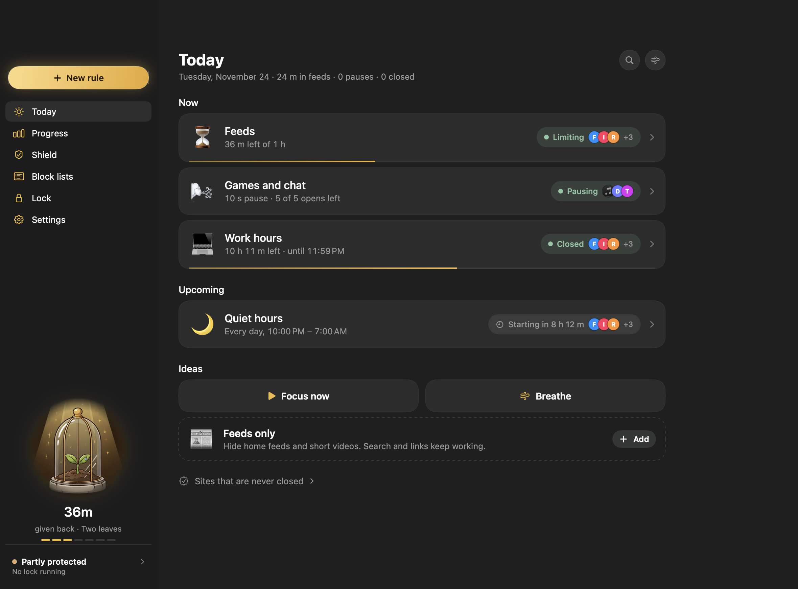

# Hisn · حصن  and  Unrot

[](https://github.com/hamzabinjehad/AdultContentBlocker/actions/workflows/ci.yml)

**One on-device engine that blocks adult content first, then helps with screen time and endless scrolling.**
It ships as two apps that share the same blocking system:

| | **Hisn · حصن** | **Unrot** |
|---|---|---|
| For | Muslims who want to stay away from zina and porn | Anyone fighting porn, doom-scrolling and lost hours |
| Look and words | Islamic: Arabic and English, sayings, prayer times, Hijri date | Neutral: the sprout under glass, trees, gold "Glasshouse" look |
| Blocking | **The same engine** (see below) | **The same engine** (see below) |

Matching runs on the device. Nothing about your browsing is reported, and every
layer says plainly what it does not cover. Read [Positioning](docs/POSITIONING.md)
for why it exists and the [Threat model](docs/THREAT_MODEL.md) before changing
anything that blocks.

<p align="center">
  
</p>

## One blocking system, two editions

The edition only changes the look, the words and the extra pages. Every
blocking piece is shared code:

| Platform | Shared blocking engine | How the edition is chosen |
|---|---|---|
| Android | `android/core` (DNS filter, adult-TLD and keyword guards, word and image checks, app limits, protection lock) | Gradle flavor: `hisn` or `general` (Unrot) |
| iPhone & iPad | `HisnDNSProxy`, Screen Time shield and activity monitor, Safari blockers | Two Xcode projects, `HisnMobile` and `UnrotMobile`, built from the same extensions; `ios/Shared/Edition.swift` |
| Mac | `HisnFilter` content filter, browser guard, locks | `HisnEdition` Info.plist key (`MacEdition.isUnrot`) |
| Browser | `extension/` (domain list, page text, on-device image/video checks, distraction rules) | One extension for both |
| Lists | `blocklist/` builds and signs the list, `seed/` is the copy bundled into every app | Same list for both |

A fix to blocking lands once and reaches both apps.

## What it blocks

1. **Adult content** (the main job): a signed list of about 236,000 core domains
   bundled offline (5.2 million in the full list), the `.adult` `.porn` `.sex` `.xxx`
   domains, 116 hostname terms, Arabic-aware page text, and optional on-device
   image checks.
2. **Screen time**: per-app daily limits, a wait before opening, schedules and
   quiet hours.
3. **Scrolling**: "feeds only" hides home feeds and short videos (Reels, Shorts)
   while search and links keep working.

A protection lock freezes your rules for a set time, so a weak moment cannot
undo them.

## Platforms

| Platform | State | Start here |
|---|---|---|
| Android | 1.0.0 beta, signed direct APK · Android 6.0+ | [Android README](android/README.md) |
| iPhone & iPad | 1.8.0 development · needs a signed device | [iOS README](ios/README.md) · [direct install](docs/IOS_DIRECT.md) |
| Mac | 1.1.18 development · needs Developer ID signing · macOS 12+ | [Mac setup](docs/SETUP.md) |
| Browser (Chrome, Edge, Brave) | 1.5.3 · unpacked, not in the store yet | [Using the extension](docs/EXTENSION_USAGE.md) |
| Router / network | Signed DNS rules for admins | [Network tools](network/README.md) |

Exact versions: [versions](docs/VERSIONS.md). What is still unproven:
[1.0 readiness](docs/1.0_READINESS.md). Past release notes:
[changelog](docs/CHANGELOG.md).

## Repository layout

```
android/      Android app (Kotlin/Java). core/ = shared blocking engine with plain-Java tests
ios/          iPhone & iPad: Hisn/ and Unrot/ apps, DNS filter, Screen Time and Safari extensions
macos/        Mac app, content filter, Safari extension, browser bridge
extension/    Chromium MV3 extension with on-device image/video checks
blocklist/    list pipeline: fetch → merge → sign            (Python)
seed/         signed starter list bundled into every app
shared/       Apple-platform code used by both iOS and Mac
network/      DNS rules for routers and admins               (Python)
profile/      .mobileconfig and Windows policy generators    (Python)
website/      product page and the Vault (passcode kept off the device)
partner/      the accountability partner's approval page
docs/         guides, plans and dated release records (index: docs/README.md)
design/       mockups and screenshots behind each design pass
```

## Testing

```bash
./test.sh                                  # python, seed, extension, release, macos, ios
./test.sh python seed                      # suites that run on any OS
cd android && sh test-core.sh              # Android blocking engine (JDK 17+)
extension/eval/run.sh                      # score the evaluation corpus
```

`./test.sh` is the same script CI runs. A suite whose toolchain is missing
fails rather than skips. Building, signing and releases:
[development notes](docs/DEVELOPMENT.md) and the
[release runbook](docs/RELEASE_RUNBOOK.md).

## Protection layers and their limits

| Layer | Closes | Defeated by |
|---|---|---|
| DNS filter (phone, Mac, router) | Listed hosts and adult TLDs in every app | Outside DNS, a VPN or tunnel, another network |
| App guard (Android accessibility, iOS Screen Time) | Chosen apps, words on screen, time limits | Turning the permission off when no lock is running |
| Browser extension | Domains, page text, on-device image/video samples | Another browser, removing the extension |
| Mac content filter | New connections on the Mac | Admin or recovery access |
| Accountability partner | Loosening an active lock | A second device with no protection |

No setup survives someone who holds the admin, recovery or supervision
credentials. To make protection hard to remove, use each platform's own
lock-down: a guardian account on the Mac, a supervised iPhone, a standard user
on Windows. See [Guardian mode](docs/GUARDIAN_MODE_PLAN.md).

## Privacy

Matching happens on the device. Do not build a feature that reports which sites
someone tried to visit: a server log of blocked adult domains tied to people is
the most damaging thing this project could hold. The accountability partner
learns only that a release was *requested*, and when.
[Privacy policy](PRIVACY.md) · [Security](SECURITY.md) · [Support](SUPPORT.md)

## Licensing note

Original work; it does not fork SelfControl (GPL-3.0) or copy HaramBlur's AGPL
code. The bundled visual runtime and upstream blocklists keep their own
licences: see `extension/visual/notices/` and `blocklist/sources.json`.
