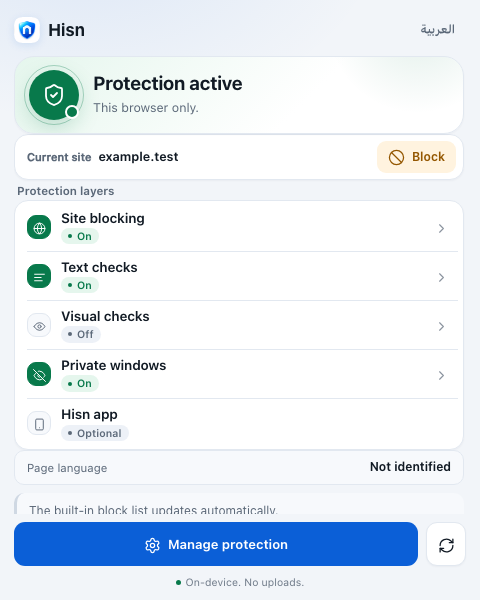
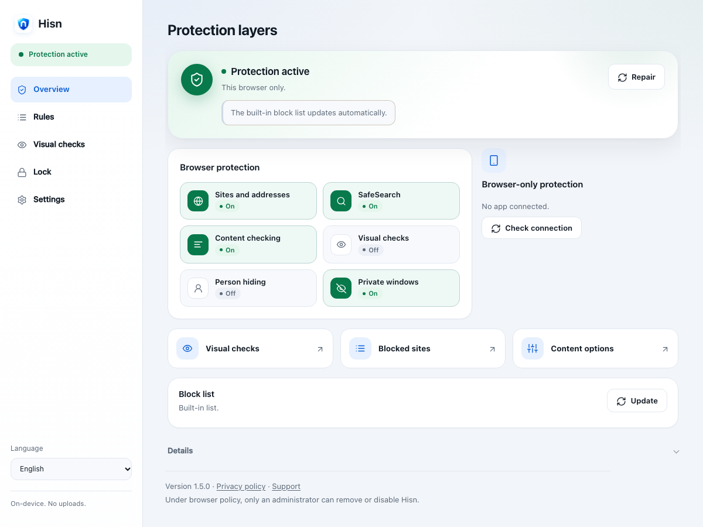
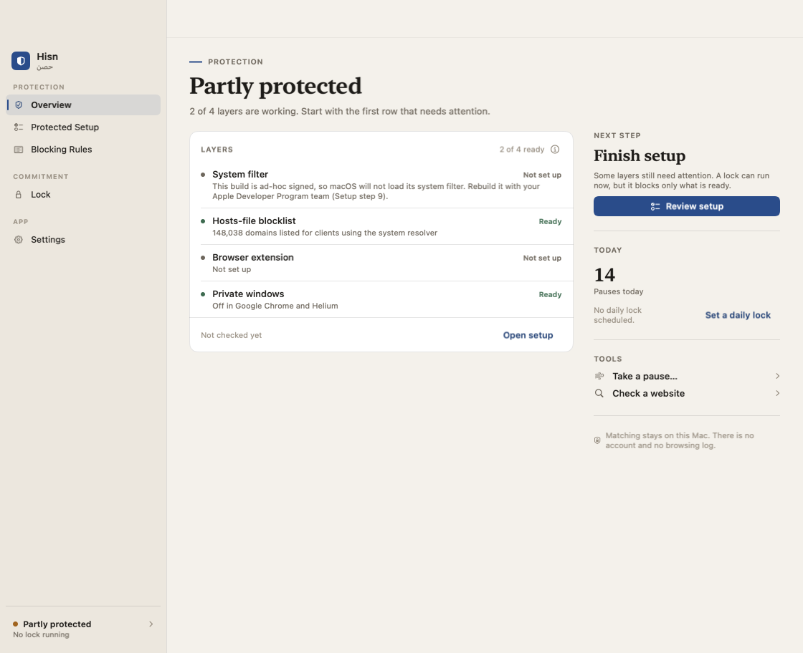
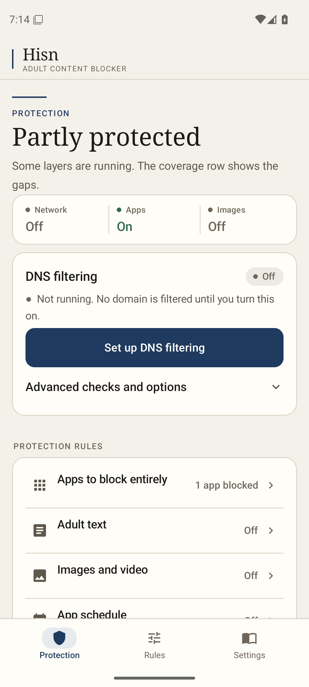
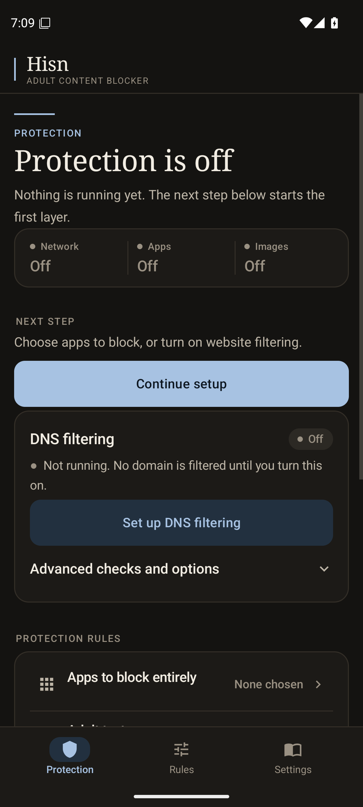

# Hisn · حصن

[](https://github.com/hamzabinjehad/AdultContentBlocker/actions/workflows/ci.yml)

**Arabic-aware adult-content protection for the browser, Mac, iPhone, iPad and Android.**
Matching runs on the device, nothing about your browsing is reported, and every
layer says plainly what it does not cover.

Hisn is built to work *under* each platform's own controls (Screen Time, Family
Sharing, MDM, a separate admin account), not to replace them. The platform gives
you the lock; Hisn adds the coverage those built-in filters miss. Read
[Positioning](docs/POSITIONING.md) for why it exists, and the
[Threat model](docs/THREAT_MODEL.md) before changing anything.

## Latest

- **Mac — the app now runs on macOS 12 (Monterey).** The deployment target
  moved from 13 to 12: the content filter, the Mach-service XPC channel and the
  lock stores never needed 13, only the SwiftUI shell did. The menu bar item is
  an `NSStatusItem` whose rows are built from state, the sidebar is an
  `HSplitView`, the main window is hidden rather than closed because macOS 12
  cannot reopen a `WindowGroup` window, and `Grid`, the `Layout` protocol and
  `OSAllocatedUnfairLock` each have a macOS 12 spelling. macOS 13 and newer keep
  their current look and API paths. Builds and tests run at the 12 target; the
  app has not been launched on a booted macOS 12 machine. Record:
  [the macOS 12 note](docs/MACOS_12_SUPPORT.md).
- **Android 1.6.0 — the committed candidate, with the reconnect lifecycle.**
  The 1.5.3 feature set, signed list updates, readiness receipts, rule tools and
  the 1.5.4 lifecycle now build as **1.6.0 / 43**. `onCreate` proves the bound
  guard, `onRebind` re-arms, a live event restores `connected`, and the
  dashboard asks a live but not-yet-connected service to re-arm on resume; the
  reconnect copy names Accessibility → Installed apps. Development candidate:
  no signed artifact, no phone run, and the post-reboot dashboard remains
  unverified. Record: [the 1.6.0 note](docs/ANDROID_1.6.0.md).
- **iPhone & iPad 1.8.0 — a device-wide DNS filter, and a direct build.** The
  new `HisnDNSProxy` Network Extension answers Hisn's signed list (236,586
  domains), the four adult TLDs, the 116 hostname terms and the person's saved
  sites with a local NXDOMAIN for **every app's system DNS**, and sends only
  allowed names to Cloudflare Families over HTTPS. The old Family DNS profile
  used Cloudflare's categories rather than Hisn's list and covered no
  non-WebKit app; it is gone. Domain and term data are generated from the
  signature-verified seed at build time and checked again by SHA-256 at start;
  a damaged domain list stops the extension, while a damaged term file leaves
  the domain list enforcing. The app gains on/off, readback, a route self-check
  through a reserved `hisn.invalid` alias and a commitment freeze. It is
  distributed **directly** as an IPA outside the App Store
  (`ios/direct/build_direct.sh` plus an AltStore source from
  `make_source.py`); Apple still enforces `dns-proxy` and Family Controls, so
  the installer's profile must carry them. Simulator-tested only; the extension
  and install need a signed device. [1.8.0 record](docs/IOS_1.8.0.md) ·
  [direct install](docs/IOS_DIRECT.md).
- **Hisn Vault (web)** — the Screen Time passcode can now be kept **off the
  device**: a static page in [`website/`](website/) seals it under a random
  32-byte key, wraps that key to a partner's P-256 key **and** to a future drand
  quicknet round, and shows the code once for the setup window. Deleting the app,
  clearing the browser or reading the file reveals nothing; the date path opens
  only when the threshold network has produced that round's beacon. 16 Node
  tests (including a live beacon round-trip) and a headless-Chrome end-to-end
  pass; no hosting, no account, and the Apple Account reset / erase / another
  device limits are unchanged. Record: [the web vault note](docs/WEB_VAULT.md).
- **Unlisted-host guard, every surface** — a name under `.adult`, `.porn`,
  `.sex` or `.xxx` is now blocked by the **extension 1.5.3**, **Mac 1.1.17**,
  **iPhone & iPad 1.7.2** (and **1.8.0**'s system-DNS filter) and **Android 1.2.2** before any list has heard of
  it; the four rules are policy constants, so they answer without a list entry
  (the Android DNS service still needs its seed to start). **Android** also
  gains the 116-term hostname-keyword layer the Mac and Chrome already had,
  read from the signed seed before the DNS tunnel starts. A hand allowance still wins, `.cam` is deliberately not guarded, and
  random new generic-TLD names remain list-dependent. Details and limits:
  [the guard record](docs/BLOCKING_GUARD_2026-11-06.md).
- **Blocklist v6** — the first signed list generation is published:
  **5,274,046 domains**, 239,885 core and 5,831 terms, verified over HTTPS and
  served with HTTP 200. The bundled seed stays v5, re-cut on 6 November with
  **236,586 core** domains, 5,280,200 in the full list and the six MDisk/TeraBox
  link hosts added from the adult-apps research; iOS and Android still update
  with an app build.
- **Extension 1.5.3** — the adult-TLD guard above, plus a popup repair: the
  status screen paints its Hisn-app row, lock strip, notices and Details again
  after a 1.5.1 reference error, and the settings page embedded in the popup
  now gets the popup's height. One row of five tabs fits, the full-page footer
  and language row are gone from the embedded view, the language switch moves
  into the compact editor bar, and the ambiguous "Settings" tab is renamed
  "Content" beside the Content options page. 1.5.2's private-window heartbeat
  answer and 1.5.0's **Move your rules** export/import remain. Record:
  [the popup UX note](docs/EXTENSION_POPUP_UX_2026-11-06.md).
- **iPhone & iPad 1.7.0** — a **pause rule**: a fourth app-rule mode where the
  shield asks **Is this important?** instead of only closing. **Pause first**
  hands the request to Hisn, a ten-second breath unlocks one session of the
  chosen minutes, opens are limited per day, and the device monitor re-shields
  when the session ends. The shield can only hand over, never grant; a damaged
  budget record closes the day. 1.6.0's browser/VPN guard and Lock Center, 1.5.0
  overview and 1.4.0 shield remain.
- **Mac 1.1.18 — the MDM profile can own the filter, and the Mac gets its
  craft pass.** Add `--mdm --team-id` to the profile generator and the profile
  carries a `com.apple.webcontent-filter` plugin payload plus a
  `com.apple.system-extension-policy` that makes the signed Hisn filter
  non-removable on macOS 15+; an MDM build also blocks Erase All Content and
  Settings, and macOS 26+ loses Safari private browsing. `--maximum` is the
  supervised-fleet preset, and `verify_mdm.sh --strict` checks the layers.
  The same release keeps the adult-TLD rail and the ink-and-paper craft pass
  (see the Mac records below). 1.1.17's enrollment probe and guided handoff
  remain.
- **Mac 1.1.16** — the filter now reports an aggregate count of denied
  connections for the current local day (no host, app or address) in the menu
  bar and the Overview's layer details; a dropped XPC reply no longer abandons
  the authority request batch; and the menu bar shows the lock's coarse time
  left. 1.1.15's Organization Mode and 1.1.14's first-run/private-window pass
  remain.
- **Android 1.2.3 — the phone reads the screen off its main thread.** The
  accessibility tree walk moved to a daemon scanner thread, so a large feed no
  longer stalls the service; a selected app's own event can block a promotional
  label before the walk, the walk reads 1,024 nodes and can stop at a partial
  match, and a static screen is still reread every three seconds. The image
  layer keeps its local model warm while the screen is on, captures at the
  model's 224 px input edge, gives a frame 5 s and backs off protected windows
  instead of polling them four times a second. Signed Play/direct builds, the
  core suite, the device runner and an emulator stress case pass; no 1.2.3
  phone run is claimed. Record: [the 1.2.3 note](docs/ANDROID_1.2.3.md).
- **Android craft pass (development, on the 1.2.3 tree).** The three tabs move
  to the Mac's warm paper and ink: a tracked page line, one serif verdict, a
  three-column coverage ledger in place of tinted tiles, and one next action.
  Rules opens with twelve named site chips that write the ordinary blocked-domain
  list, so a chip is not a hidden category and a protection lock freezes it like
  every other rule. The block page leads with a breath and keeps the exit
  visible; the reminder and four needs appear only after the third breath. The
  welcome, settings and direct-build shield surfaces follow. No enforcement,
  permission, consent text or version changed, and the signed 1.2.3 artifacts
  predate the pass. Record:
  [the craft pass](docs/ANDROID_CRAFT_2026-11-07.md); captures:
  [design/android-craft-2026-11-07](design/android-craft-2026-11-07/README.md).
- **Android 1.2.2** — the DNS tunnel now applies the same hostname-keyword
  contract as the Mac and Chrome (`HostTermPolicy`, the adult TLDs and the Arabic
  and Franco-Arabic folds) to names no seed list carries, after the person's own
  allowance. Two fixes from the day's live protection pass ride with it: a
  granted accessibility service no longer reads as **Permission required** when
  Android's cached manager list is stale, and the guard arms itself from its
  first event if Android rebinds it without repeating the callback. A classifier
  failure retries after 5 s with a doubling backoff capped at the previous 30 s
  instead of blinding the photo/video layer for half a minute. The day's
  interface pass (one line per rule, section labels, a page-aware bar, a hero
  tinted by its verdict) and 1.1.1's weekday schedule are unchanged.
- **iPhone & iPad 1.6.0** — a **browser and VPN guard**: a second,
  always-block app rule for the browsers and VPN apps that route around Safari
  blocking, frozen during a commitment and watched by the monitor's layer-loss
  check; and a **Lock Center** that turns removal protection into the honest
  ladder — one row per level with what it stops and the exit it keeps, saying
  plainly that no level stops an Apple Account passcode reset, device erasure
  or another device. The 1.5.0 card-stack overview, 1.4.0 bilingual shield
  with no unlock, 1.3.0 pause, quiet hours and saved-rule freeze remain.
- **iPhone & iPad 1.5.0** — a UI/UX pass: the overview is a calm card stack
  (status, pause, plan progress, lock and rules), the lock, blocked-site and
  app-limit cards open their editors directly, Setup is three guided steps with
  a checks card, and Settings is grouped cards. Design research used REA 6.8.0
  on ScreenZen 2.0.0. The 1.4.0 bilingual Screen Time shield with no unlock, the
  1.3.0 pause, quiet hours and saved-rule freeze remain.
- **Mac 1.1.15** — **Organization Mode**: a forced `HisnManaged` preference
  from a profile puts the app under an organization, shows its name, hides
  local removal and weakening controls, and makes Settings, Rules, the partner
  key and the gray-screen switch tightening-only. `profile/make_profile.py
  --managed --organization-name …` emits the app payload beside the browser
  private-window policies with `PayloadRemovalDisallowed`; real removal
  resistance still needs MDM/supervision and a standard account. The 1.1.14
  welcome/Overview and **Private windows** status layer remain.
- **Android 1.1.0** — a first-run welcome, a voluntary pause on Protection and
  today's usage in the daily-limit editor sit on the 1.0.0 protection lock,
  removal guard, managed lockdown and layer watchdog. The signed direct APK is
  published on GitHub Releases; the Play AAB is not uploaded.

These are development candidates. No store listing or physical-device
acceptance is claimed; the Android 1.1.0 direct APK is the published build (1.2.2
is a development build) and the Play AAB is not uploaded. The exact state is in
[versions](docs/VERSIONS.md) and [1.0 readiness](docs/1.0_READINESS.md).

### Interface

<p align="center">
  
  
</p>

The extension popup and dashboard lead with one protection status and one-word
layer states. The current captures, including Arabic, the rules editor, visual
checks, content options and the block page, are in the
[UI refresh record](design/extension-ui-2026-11-04/README.md). The design
research behind the pass, including the REA comparison with ScreenZen, is in
[the 2026-11-04 note](docs/EXTENSION_UI_REFRESH_2026-11-04.md).

<p align="center">
  
</p>

The Mac window is a warm-paper surface with a two-column Overview, a layer
table, a compact commitment rail and one serif statement per page. The current
captures, including dark, Arabic RTL and the 760-point layout, are in the
[Mac craft pass](design/macos-craft-2026-11-07/README.md).

<p align="center">
  
  
</p>

The Android app opens on a warm-paper verdict, reads the three layers as one
coverage ledger, and keeps one filled action on the page. Rules adds named site
chips; the block page is a breath first and a reflection second. The three tabs
in English, Arabic RTL and both palettes are in the
[Android craft pass record](design/android-craft-2026-11-07/README.md).

## Platforms

| Platform | What it does | State | Start here |
| --- | --- | --- | --- |
| Browser extension (Chromium) | Blocks listed domains and adult TLDs, checks page text in the page's language, on-device image/video checks on by default, hides the whole post on X and the main social feeds when its media is flagged, portable hand lists | 1.5.3 | [Using the extension](docs/EXTENSION_USAGE.md) |
| Mac | Content-filter system extension, adult-TLD and hostname guards, browser guard, locks, authority checks, accountability partner, root guardian daemon, an on-demand breathing pause, a read-only site checker, an aggregate blocked-connection count, MDM enrollment and a profile-managed non-removable filter | 1.1.18, needs a signed build · runs on macOS 12 or later | [Mac setup](docs/SETUP.md) · [MDM](docs/MDM_DEPLOYMENT.md) |
| iPhone & iPad | A device-wide DNS filter with the adult-TLD and hostname guards, six Safari blockers, Safari text extension, Screen Time app limits with a custom bilingual shield, a browser and VPN guard, a pause rule with a daily opens budget, protection lock for saved rules, an on-demand pause, daily quiet hours and a removal-protection Lock Center; distributed directly as a signed-on-install IPA | 1.8.0, development · needs a signed device | [iOS README](ios/README.md) · [direct install](docs/IOS_DIRECT.md) |
| Android | DNS filtering with the adult-TLD and hostname guards, selected-app and word restrictions, per-app daily time limits, first-run welcome, voluntary pause, optional image checks, browser-coverage screen, schedules, protection lock that freezes saved rules, opt-in device-owner uninstall guard and managed lockdown, direct-build removal guard, layer watchdog, bundled-list freshness warning, signed list updates, readiness receipts and portable rule tools | 1.6.0 development candidate · core and build tests, no signed 1.6.0 APK or phone run; 1.5.4 on the owner's phone; post-reboot dashboard unverified | [Android README](android/README.md) · [1.6.0 record](docs/ANDROID_1.6.0.md) |
| Network / router | Verified signed DNS rules for administrator import | Tools only | [Network tools](network/README.md) |

Seed **v5** raises the bundled core from 159,768 to **236,586 domains** on every
surface, the largest tier the browser, six Safari blockers and the Android seed
can hold without truncation. The selection rules, the 1,261 domains deferred by
capacity and the licensing boundary are in the
[coverage pass record](docs/COVERAGE_PASS_2026-10-30.md). A signed **lists v6**
generation (5,274,046 domains) is published for the Mac filter and the browser's
list update; the seed remains the offline fallback. The evidence, hashes and the
guard refusal that preceded it are in
[the publication record](docs/LIST_PUBLICATION_2026-11-03.md).

Each platform's start link is in the table; Mac users can also follow the
[Mac user guide](docs/USER_GUIDE.md). Every document is listed in the
[docs index](docs/README.md). The pinned version of every platform, and the honest release state behind it,
is in [versions](docs/VERSIONS.md); the single finish line, including what is
still unproven, is [1.0 readiness](docs/1.0_READINESS.md); per-surface
list coverage is in [coverage](docs/COVERAGE.md). The
[privacy policy](PRIVACY.md) and [support page](SUPPORT.md) are the public
statements to check before a release.

## Protection layers

| Layer | Closes | Defeated by |
|---|---|---|
| Network DNS (administrator setup) | Listed hosts on devices using the resolver | Outside DNS, tunnels, another network, gateway reset |
| Browser extension | Known domains, page text and on-device readable image/video samples in supported browsers | Another browser, removal/disablement, unreadable media, classification misses |
| Configuration profile | Supported DNS, Private Relay, and browser settings | A tunnel; an administrator removing the profile |
| Content filter (system extension) | Host/application decisions on new Mac flows | Provider loss, established flows, unidentified destinations outside strict mode, recovery/admin changes |
| Accountability partner | Ordinary user loosening an active policy | Guardian authority or recovery; a separate unprotected device |
| Browser guard (in the app) | Keeps a browser open when its extension misses a heartbeat; closes only a standard profile that confirms the extension was disabled or removed, after a five-minute countdown (unsupported browsers: one minute) | Force-quitting Hisn, explicitly trusted unknown apps, unreadable/custom profiles, guest/private windows, admin changes |

These layers address different gaps and need independent checks. A browser
model cannot replace a device/network control, while DNS and socket decisions
cannot classify every encrypted post. No combination guarantees all-content
coverage or prevents a device owner with administrator/recovery access from
undoing protections.

For the app-level layer, [apps to consider blocking](docs/APPS_TO_CONSIDER.md)
is a category-based checklist, not an "adult app" verdict: it explains what
each block costs, why browsers and messaging are high-cost choices, and what
must stay accessible.

Blocking your own sites works the same way everywhere: the extension popup's
**Block** button for the current tab, the Mac menu bar's **Block a site…**, and
iPhone/iPad **My blocked sites** (up to 49 sites through the Screen Time filter).

To make protection hard to delete or switch off, use each platform's own
lock-down: on a Mac, the guardian account split (`setup_guardian.sh`) with the
removal-password profile; on iPhone/iPad, a supervised device with
`profile/make_ios_profile.py` ([guide](docs/IPHONE_SUPERVISED.md)); on Windows,
the browser policy from `profile/make_windows_policy.py` with a standard user
account ([guide](docs/WINDOWS_SETUP.md)). No setup
survives someone who holds the admin, recovery or supervision credentials.
The managed-device route (Android device owner, Apple supervision, a guardian
console and phone-laptop pairing) is planned in
[Guardian mode](docs/GUARDIAN_MODE_PLAN.md).

## Repository layout

```
blocklist/       list pipeline: fetch → merge → sign, keyword layer, seed bundle  (Python)
network/         capability planning + verified DNS-rule publication             (Python)
profile/         .mobileconfig generator: DNS, DoH, Private Relay                (Python)
extension/       Chromium MV3 extension + on-device local visual engine        (JS)
macos/           the app + content filter                                        (Swift)
ios/             universal iPhone/iPad app, Safari blockers + device DNS filter (Swift)
android/         DNS, selected-app/text and opt-in visual protection preview      (Java)
ipados/          iPad-specific documentation; shares the ios/ target
shared/apple/    portable Apple-platform configuration and protection-state code
seed/            signed starter list + keyword layer, bundled into each client
partner/         the accountability partner's page: key, and signed approvals    (HTML)
docs/            guides, plans, release records and the docs index
.github/         CI on every PR; daily signed rebuild and publish                 (Actions)
```

## Testing

```bash
./test.sh              # python, seed, extension, release, macos, ios
./test.sh python seed  # the suites that run on any OS
./test.sh browser      # the page scanner in headless Chrome (CI always runs it)
./test.sh ios          # mobile unit tests + a locally available iOS simulator
extension/eval/run.sh  # score the evaluation corpus; a blocked benign page fails
cd android && sh test-core.sh   # Android core suite (JDK 17+)
```

`./test.sh` is the same script CI runs. A suite whose toolchain is missing fails
rather than skips: "the tests passed" has to mean they ran. The default run needs
Xcode and an installed iOS Simulator runtime; name suites explicitly for a
narrower run.

Building, signing, the seed bundle, the extension, the Mac app, the native
messaging host and lock lengths are covered in
[development notes](docs/DEVELOPMENT.md). Maintainers releasing a build follow
the [release runbook](docs/RELEASE_RUNBOOK.md) and record results in
[release validation](docs/RELEASE_VALIDATION.md); every change is summarized in
the [changelog](CHANGELOG.md).

## Privacy

See [SECURITY.md](SECURITY.md) for private vulnerability reporting and the limits that are documented product boundaries, not bugs.

Domain matching happens entirely on-device. Do not build a feature that reports
which sites a user tried to visit. A server-side log of blocked adult domains,
tied to identities, is the most damaging thing this company could hold, and one
breach away from ruining the people it was built to help. The accountability
partner learns that a release was *requested*, and when — nothing else.

## Licensing note

This deliberately does **not** fork SelfControl. SelfControl is GPL-3.0, which
would require publishing any derivative under the same terms — incompatible
with a closed paid tier. The Swift here is original work built on Apple's
NetworkExtension framework, so you are free to license it as you choose.

The bundled visual runtime includes third-party libraries and model assets with
their own licenses. Preserve `extension/visual/notices/`, the linked dependency
notices and artifact provenance when redistributing. The original Hisn
integration does not copy HaramBlur's AGPL code.

Upstream blocklists carry their own licences (MIT, GPL-3.0, Unlicense) and are
recorded per-source in `blocklist/sources.json`. You redistribute the merged
list, not their code — but check the terms before shipping commercially.
