# Hisn Android: native UI redesign

**Status: design record, 11 November 2026.** The redesign is no longer a prototype. The
Compose shell is the app's launcher, reads live state and lives in
`android/app/src/main/java/app/hisn/android/nativeshell/`; the standalone app in
[`prototype/`](prototype/) remains as the design reference and its captures below are the
original design record.

**Owner decision, 11 November 2026: the native shell is the app.** `ShellActivity` is the
launcher; every layer, rules and settings row opens the classic Views activity until that
editor is ported. The duplicate packages (`app.hisn.prototype`, `app.hisn.android.nativeshell`)
were removed from the test devices, and the classic activity is no longer a launcher — it will
be deleted with the last ported editor. The 1.6.0 build also carries the unrelated personal
layer ([note](../../docs/ANDROID_PERSONAL_2026-11-11.md)). Record:
[the shell note](../../docs/ANDROID_NATIVE_SHELL_2026-11-11.md).

The prototype started as fake state. After the first review it was given a real,
saved rule set: toggles and lists persist in `SharedPreferences`, **Apps to block** reads
the apps actually installed on the phone, and **Gray screen** switches Android's own
grayscale filter. Enforcement still lives in the production app — no VPN tunnel,
accessibility binding or image model is started here.

The goal was not a new skin. It was to make the same product feel like an Android app:
platform components, system type, edge-to-edge insets, a real navigation bar/rail,
Material state layers, and layouts that survive Arabic, dark mode and large text.

## Why not the linked library list

[`pick-ui-library`](https://github.com/emilkowalski/skills/tree/main/skills/pick-ui-library)
is a curated list of **web/React UI libraries** — base-ui, Sonner, cmdk, zustand,
motion, recharts. It has no Android or AI entries, and its own instructions say not to
substitute outside the list. It cannot pick a native Android stack.

The native equivalent is **Jetpack Compose + Material 3**. Material Components for
Android (the Views library) is now in
[maintenance mode](https://github.com/material-components/material-components-android),
and Android's 2026 guidance is
[Compose-first](https://android-developers.googleblog.com/2026/05/android-ui-development-is-compose-first.html).
Hisn's current UI is hand-built Java Views; that is why it looks distinctive but not
native.

## Before and after

| Before: 1.6.0 craft pass | After: native prototype |
| --- | --- |
| 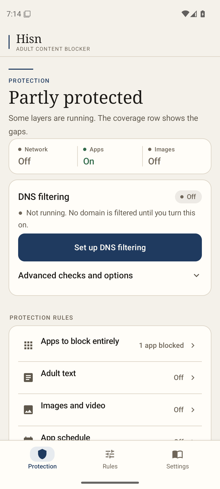 | 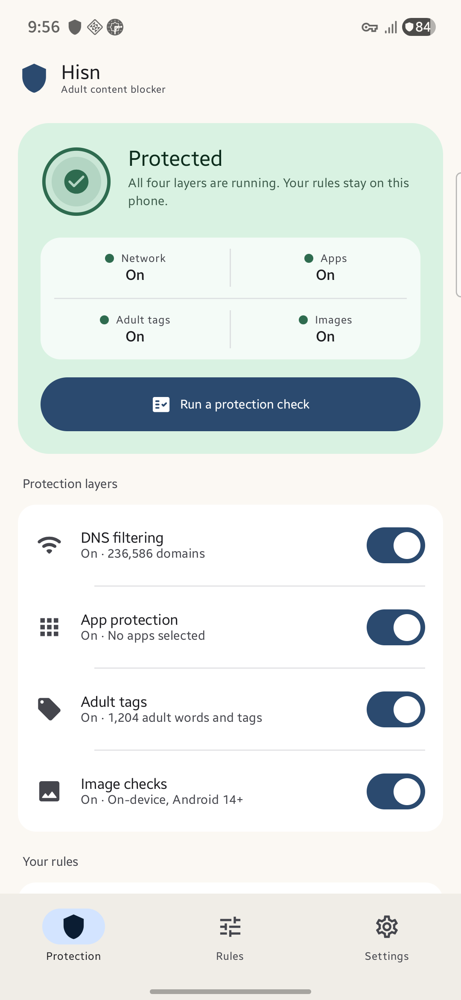 |

The old screen is an editorial layout: serif headline, hairline paper cards, all-caps
overlines, a hand-built app bar and bottom nav. The new screen keeps the warm paper
and ink-blue palette, but replaces the chrome with Material 3, uses system sans, lifts
the cards to white surfaces, and gives the status one clear action.

## What changed

- **One status hero.** Protection, attention and partly-protected states share one
  28 dp card with a semantic container, a coverage ledger (three layers on one row, four
  wrapped to 2 × 2), and exactly one primary action.
- **Real Material navigation.** `NavigationBar` on phones; `NavigationRail` at
  ≥ 600 dp. The top bar is a `TopAppBar`, not a hand-drawn brand row.
- **System type.** Roboto/system sans across display, headline, title, body and label.
  Sentence case; no all-caps tracked overlines, which also behave badly in Arabic.
- **Lifted surfaces.** White cards in the light theme (`#FFFFFF`) and `#1E2022` in
  dark, on the warm canvas at 16 dp radius; the hero uses 28 dp. Dividers are inset to
  the text, not drawn edge to edge.
- **Plain leading icons.** One 24 dp icon per row instead of a repeated blue badge.
  The circular badge is kept only for status/issue icons, where it carries meaning.
- **Clear switch states.** On = primary track; off = outlined neutral track. The whole
  row is the toggle target, not just the 52 × 32 switch.
- **Adaptive width.** Content is capped at 840 dp; the tablet layout is a rail plus a
  centred, self-contained 840 dp column.
- **Dynamic color, opt-in.** `Use system colors` switches to the Android 12+ wallpaper
  scheme; the brand scheme stays the default.
- **Reduced redundancy.** The old page repeated “what is running” in the hero, the
  attention card and every layer tile. The new page says it once, then lists the layers.
- **Native motion, specified.** Directional tab transitions, a predictive-back detail
  push, a coverage-ring seal, swipe-to-remove with undo, a theme bottom sheet, haptics and
  reduced motion. See [Motion and interaction](#motion-and-interaction).

## Motion and interaction

A screenshot cannot show this pass, so the tokens are written down. They are Material 3's
2026 motion scheme rather than an invented curve: spatial springs **0.9 / 700** (standard),
**0.9 / 1400** (fast), **0.9 / 300** (slow); effects — colour and alpha — critically damped
**1.0 / 1600**; fades **200 / 90 ms**. Anything that can be interrupted (position, size,
shape) is a spring; only opacity is a tween. The `--ez` capture overrides still work, and
`Remove animations` zeroes the whole set.

| Moment | Motion | Why it reads as Android |
| --- | --- | --- |
| Tab switch | `AnimatedContent`, 1/6-width shared-axis slide + 180 ms fade, 300 ms; mirrored in RTL | Direction follows the tab order, like `ViewPager`/navigation suites |
| Detail push | 450 ms slow spatial spring; the shell scales to 0.945 and steps aside; 16% scrim | The pushed page has depth without a full-screen crossfade |
| Predictive back | The finger drives the push; cancelling springs it back, committing finishes the slide | The API 33+ gesture is not swallowed by a plain `BackHandler` |
| Hero state | Colour 320 ms; title and body crossfade; the seal's ring springs to the coverage count | Status changes without re-laying out the card |
| Coverage ledger | Each dot's colour and scale spring; the On/Off word crossfades | The gap is legible in motion, not just at rest |
| Fix gaps | Missing layers arm in a 90 ms cascade with a tick per layer, then Confirm + snackbar | The repair is visible as four steps, and undo is one tap |
| Check / pull | The seal spins for 900 ms, then Confirm + snackbar | `PullToRefreshBox` supplies the platform indicator |
| Lists | `Modifier.animateItem` placement spring; swipe reveals a red Remove background; snackbar Undo | The list closes its own gap; no dead row |
| Theme | `ModalBottomSheet`; selecting a theme animates every visible colour role over 320 ms | No flash of the old surface when the scheme changes |
| App picker | Six shimmer skeleton rows while `PackageManager` is read | The page keeps its final shape instead of jumping from a spinner |
| Numbers | 220 ms vertical roll with tabular figures | Counts change without the row resizing |

The hero's seal is the coverage state itself: **4/4** draws a full ring, **3/4** leaves a
visible gap, a check makes the ring spin, and closing the last gap fires a single 780 ms
halo. The ring is a `Canvas` in the draw phase, so it never recomposes the card. When
`Remove animations` is on, the halo and the cascade delays are skipped and the seal shows
the static coverage arc.

Motion is also feedback. Switches use `ToggleOn`/`ToggleOff`; adding or fixing confirms;
invalid domains and words reject; chips and navigation tick. These are Compose's
`HapticFeedbackType`s, so the system's own haptic setting still decides whether the phone
buzzes, and no `VIBRATE` permission is added.

Accessibility was kept in the same pass: the hero title is a polite live region, every
target is at least 48 dp, the theme sheet is a real radio group, and the reduced-motion
local reads both `ANIMATOR_DURATION_SCALE` and `TRANSITION_ANIMATION_SCALE`. The remaining
gap is a full TalkBack pass and an API 23 motion test; neither is claimed here.

No third-party motion dependency was added. GitHub's official
[android/skills](https://github.com/android/skills) collection and the AndroidX sources show
that `AnimatedContent`, predictive back, `animateItem`, haptics and the Material 3 motion
scheme cover every interaction above; Lottie or a JS animation library
would only add weight and a second timing model.

## What you can tap in the prototype

The prototype is no longer a set of dead rows, and it no longer loses what you chose:
every rule is written to `SharedPreferences` when it changes and read back at launch.

- **Protection layers** — DNS filtering, app protection, **adult tags** and image checks.
  Each switch is the real saved rule; the hero's **Fix gaps** re-arms all four, and the
  layered coverage ledger flips between **Protected / Partly protected / Needs attention**.
- **Blocked domains / Blocked words** — add with inline validation (the field turns red
  and the haptic rejects), swipe a row left or right to remove it, or use the trash button;
  both remove paths offer **Undo** and the counts on Protection and Rules update. The list
  survives a restart.
- **Apps to block** — a picker over the phone's own launchable apps (`PackageManager`,
  `MATCH_ALL`, declared `<queries>` for `MAIN`/`LAUNCHER`): real icon, real label, package
  name, search box, blocked-first ordering. The choice is saved by package name, so it
  still matches after the app is renamed or updated.
- **Quick blocks — removed.** The chip row duplicated the domain list and added nothing;
  domains are added in **Blocked domains** only.
- **Built-in checks** — Adult tags, Images and video, Short videos and Gray screen are
  independent switches with state-aware supporting text. **Gray screen** writes Android's
  `accessibility_display_daltonizer_enabled` / `…_daltonizer` settings through
  `WRITE_SECURE_SETTINGS`; without that one-time `adb` grant it explains the grant and
  opens Accessibility instead of silently pretending.
- **Daily limit, per app** — pick the apps, give each one its own minutes (5 min − 8 h,
  edited from the row), and the row shows today's real screen time with a progress bar,
  read from Android's own on-device usage record (Usage access, granted once in
  Settings). Limits are saved by package name; the Rules row counts them.
- **Schedule / Protection lock** — choose days or a duration and save; the days and the
  Rules summary persist.
- **Theme** — a modal bottom sheet with System / Light / Dark, applied with a colour blend
  and remembered.
- **Motion** — switch tabs, open a detail page, drag back from either edge, pull to refresh,
  fix the attention state, or swipe a domain or word away. Each has haptics and an undo
  where the action is destructive.
- **Permissions, Diagnostics, word tester, info screens** — open, read, and run the
  local word test.
- **Back** — the top-bar arrow pops the detail page, `limit:apps` returns to
  `limit`, and the system back gesture drives the same push through `PredictiveBackHandler`.

What is still not real: the DNS tunnel, the accessibility text/image guard and the image
model. "Protected" describes saved rules and layer switches, not live traffic filtering,
and the About screen says so.

## Screens

### Protection

| Protected | Needs attention |
| --- | --- |
|  | 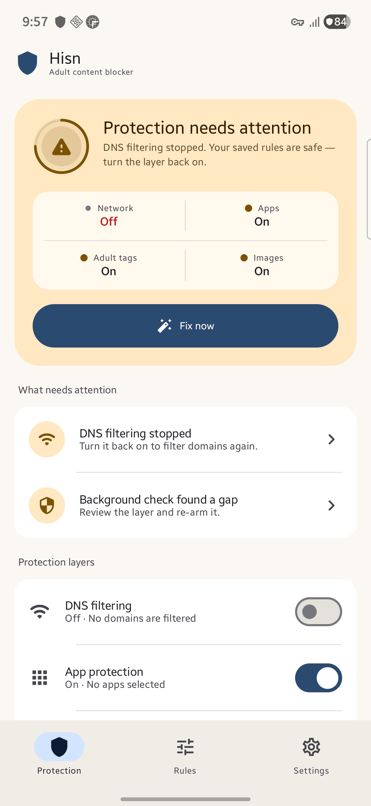 |

The hero answers three questions in order: *am I protected, which layer is the gap,
and what do I do next*. The coverage ledger (`Network / Apps / Adult tags / Images`)
gives each layer a word, not colour alone; three layers sit on one row and four wrap to
2 × 2. The attention list below the hero is the only place that repeats the gap, and each
row is an action.

### Rules

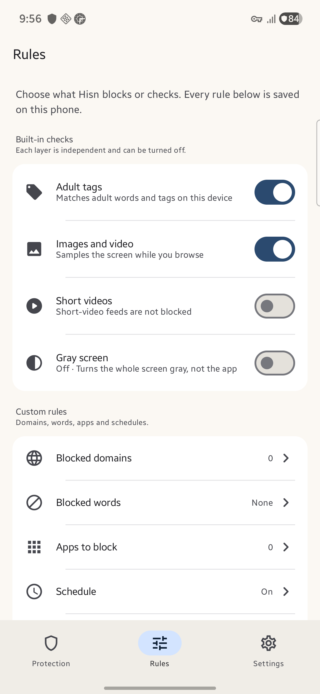

Grouped as **Built-in checks → Custom rules → Protection lock**. The old Quick blocks
chip row is gone (see [`03-rules-light.png`](03-rules-light.png) for the earlier
layout). Built-in checks are switch rows with a one-line, state-aware explanation —
"Blocks short-video feeds in the apps you choose" / "Short-video feeds are not
blocked". Custom rules are ordinary list rows with a count and a chevron. The
protection lock is its own card, not a banner mixed into the rules.

### Settings

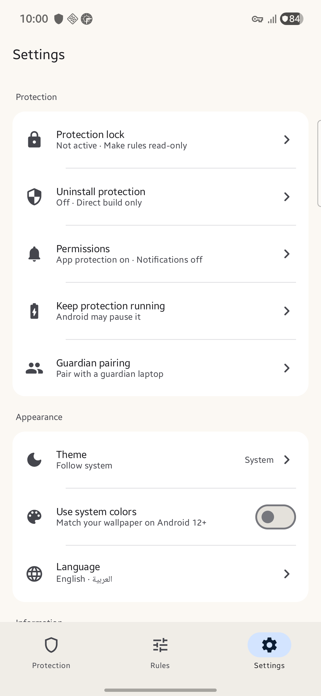

Grouped as **Protection → Appearance → Information**, with the destructive and
irreversible actions first and the diagnostics/about material last. The theme row
shows the current value (`System`) instead of hiding it. `Use system colors` is a real
switch; `Language` is a separate row.

### Dark

| Protection | Rules | Settings |
| --- | --- | --- |
| 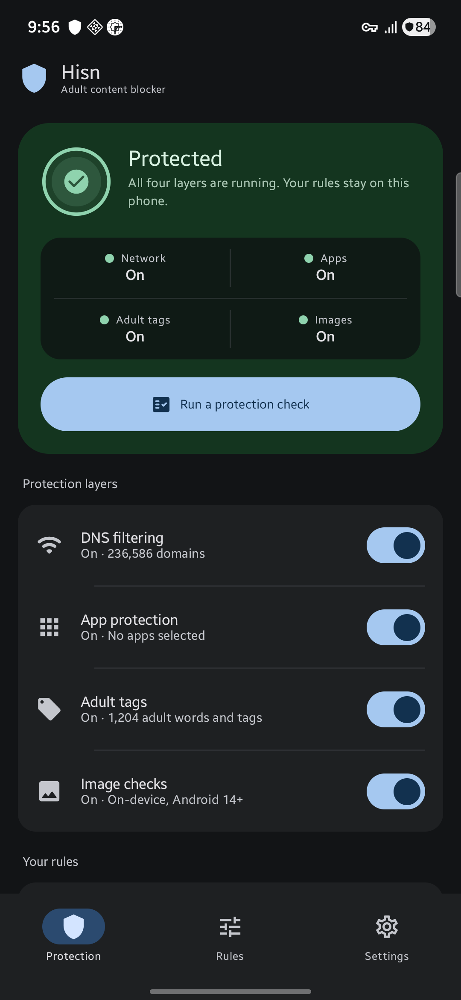 | 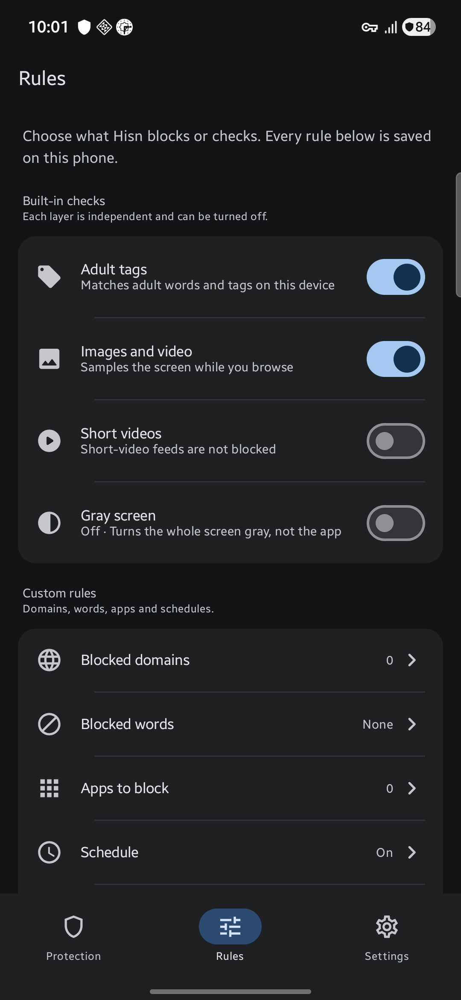 | 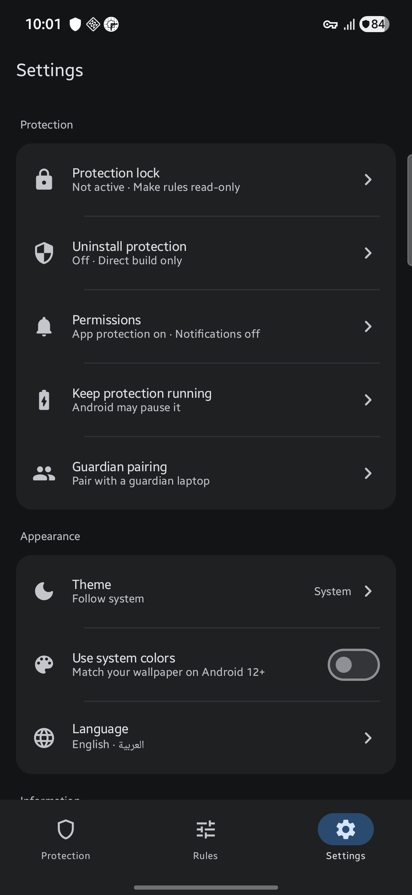 |

The dark palette is warm charcoal (`#121416`), not blue-black. Cards are `#1E2022`;
the success/warning containers are re-toned so they do not glow. Status bar icons flip
with the theme.

### Tablet

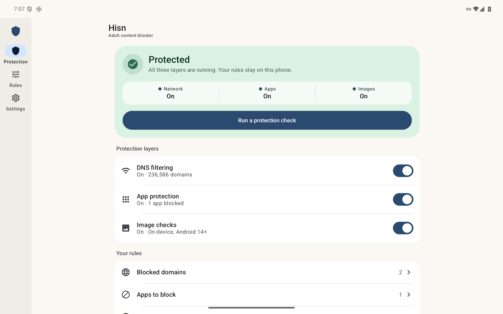

At 600 dp the bottom bar becomes a full-height `NavigationRail` with the shield mark at
the top. The content is a centred 840 dp column, so the title, hero and rows share one
left edge instead of stretching across a 12-inch screen.

### Large text and Arabic

| 1.3× font scale | Arabic, protected | Arabic, partly protected |
| --- | --- | --- |
| 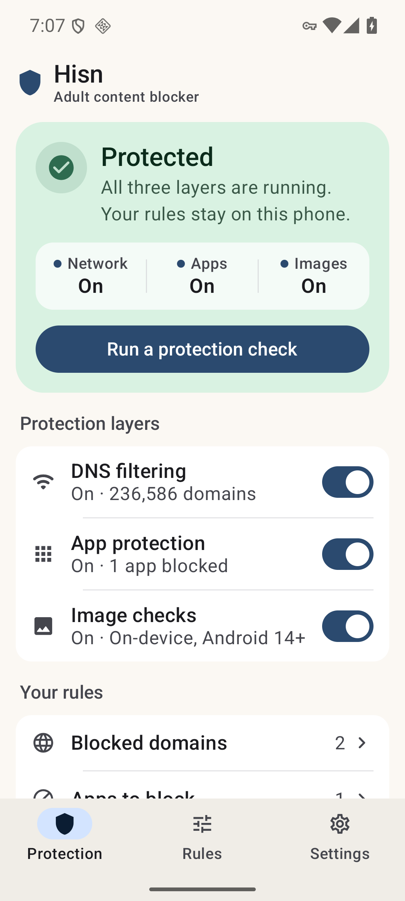 | 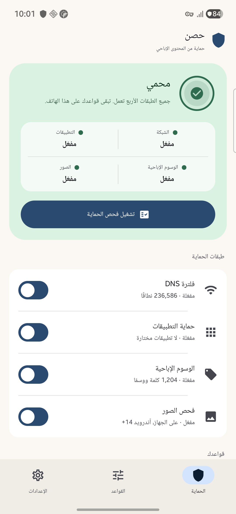 | 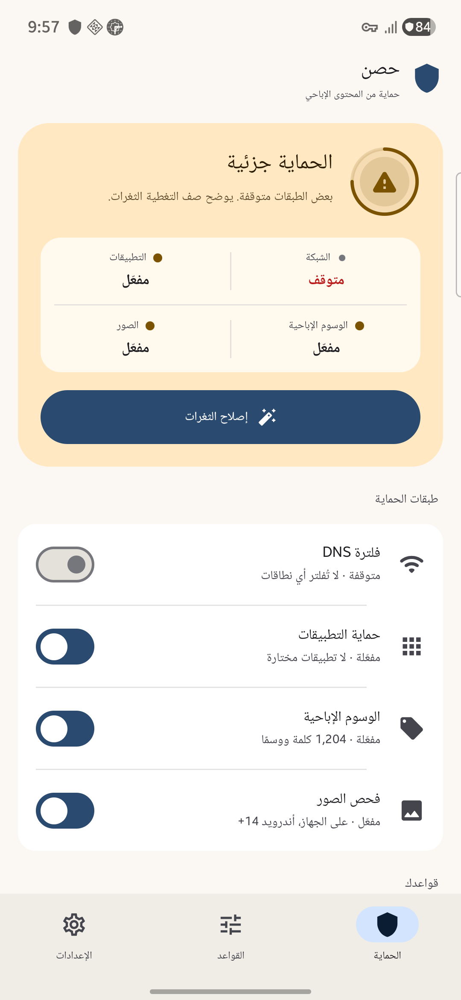 |

The Arabic screens are a real RTL pass, not a mirrored English screenshot: the rail/nav
order, chevrons, switches, status columns and text alignment all flip. The prototype
carries Arabic copy only for Protection; the production app already has `values-ar`
strings for the rest. The large-text capture is 1.3×; the layout reflows rather than
clipping.

### Functional pass

| Protection, four layers | Apps to block, the phone's own list | Gray screen permission |
| --- | --- | --- |
|  | 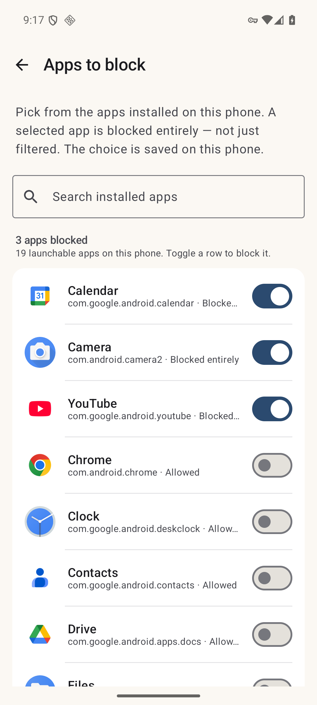 | 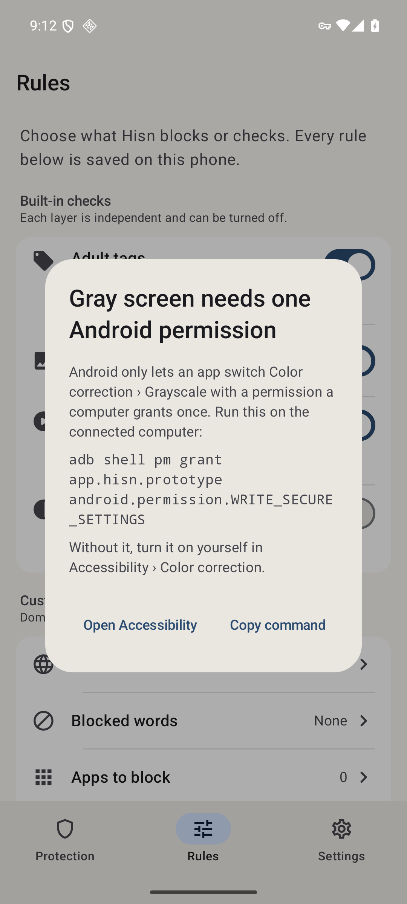 |

- **Adult tags is a fourth layer.** It shares one saved rule with the Adult tags switch in
  Built-in checks: turning it off in Protection shows it off in Rules, the hero becomes
  **Partly protected**, and **Fix gaps** re-arms it. The coverage ledger wraps four layers
  to a 2 × 2 grid so "Adult tags" and "الوسوم الإباحية" never clip.
- **Apps to block is the phone's list, not seven hard-coded names.** 19 launchable apps
  were returned on the emulator, sorted blocked-first, with the real icon, label and
  package; the search field filters on either. Blocked apps are saved by package name.
- **Gray screen actually changes the screen.** With `WRITE_SECURE_SETTINGS` granted, the
  app writes `accessibility_display_daltonizer_enabled=1` and
  `accessibility_display_daltonizer=0` (monochromacy) — the same two values Accessibility ›
  Color correction › Grayscale writes — and `settings get secure` confirmed `1`/`0` on the
  emulator. A capture cannot show the filter (screencap reads the app buffer, not the
  display transform), so the evidence is the settings value plus the row's
  "On · The whole screen is gray". Without the grant the dialog above appears and the
  switch stays off.
- **Quick blocks is gone.** The chip row, its `QuickChip` component, the `SiteDomains` map
  and the callback plumbing were removed; the empty domain state now points at the domain
  screen instead.

| Daily limit, per app | Dark, four layers | Arabic, four layers |
| --- | --- | --- |
| 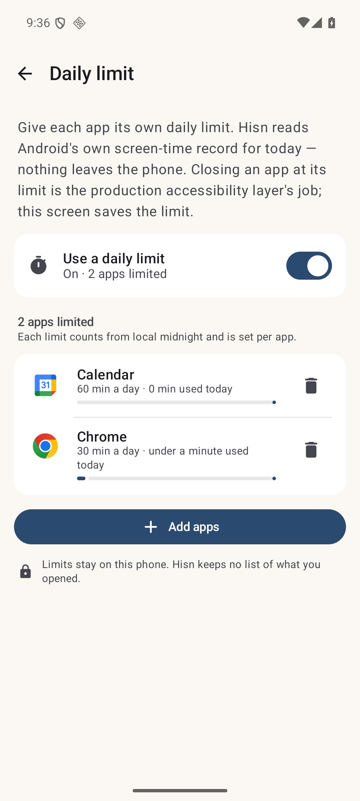 | 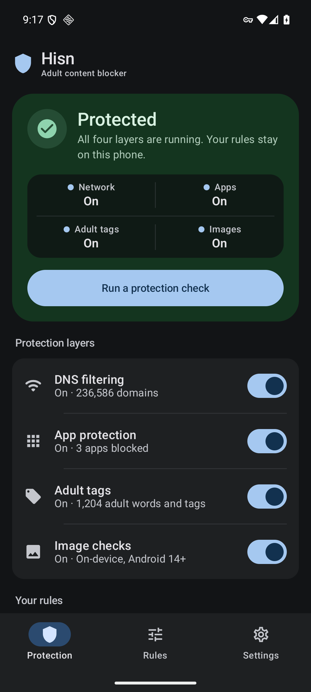 | 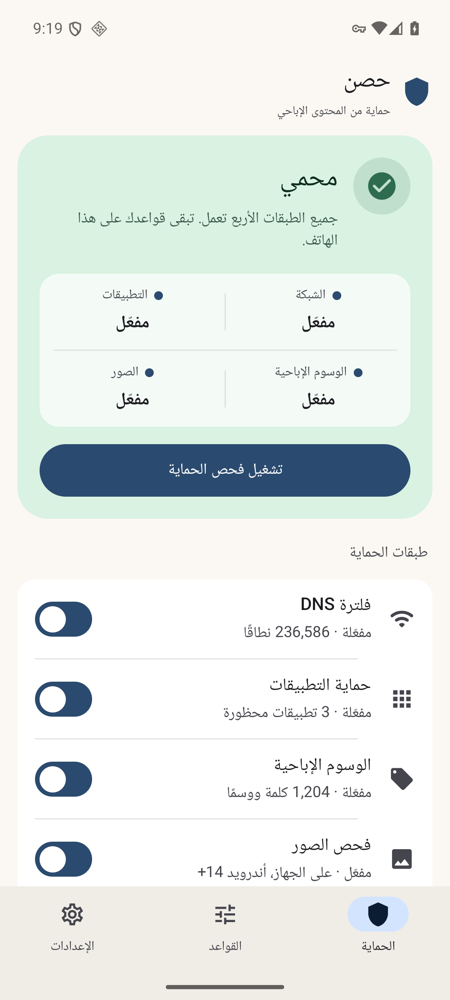 |

The per-app limit replaces the old one global minutes choice: each selected app carries its own
value, and the row reports "used today" from `UsageStatsManager` (granted through Usage access).

### Motion

| Theme bottom sheet | Swipe to remove | Undo snackbar |
| --- | --- | --- |
| 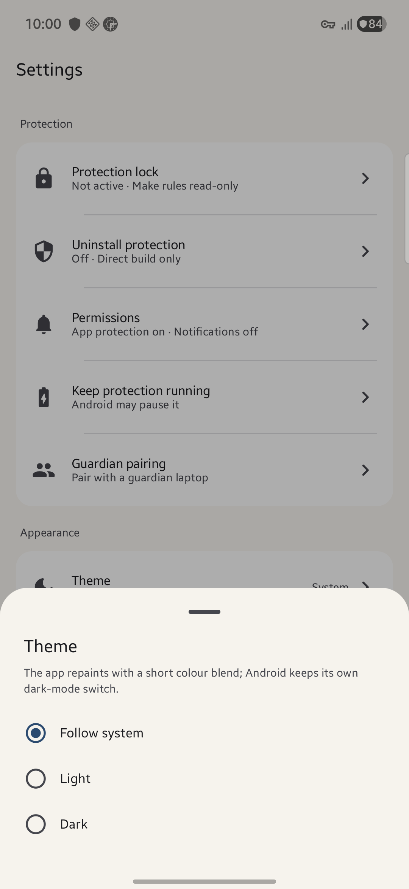 | 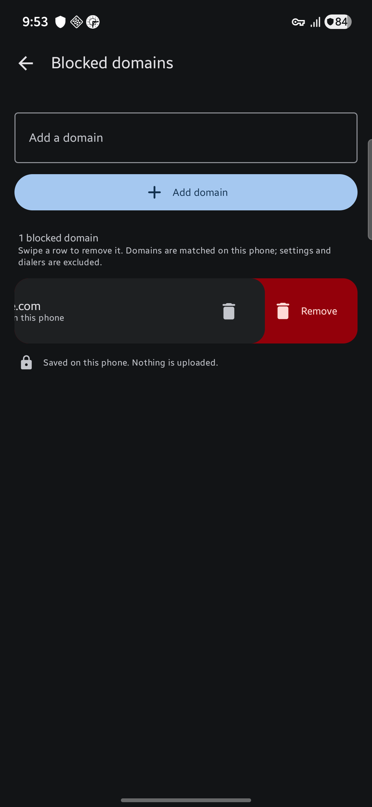 | 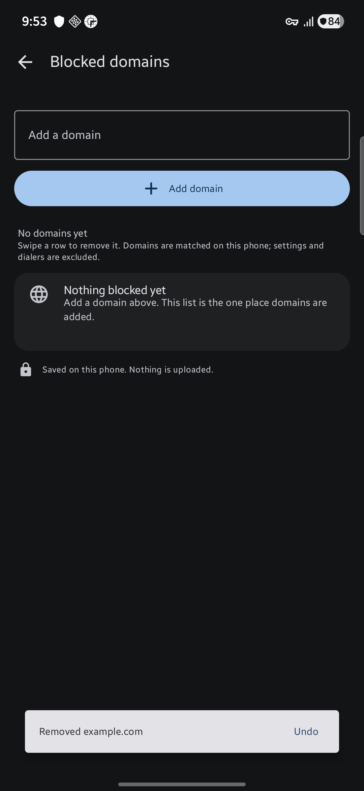 |

| Pull to check | The check result | Fix gaps, Arabic |
| --- | --- | --- |
|  | 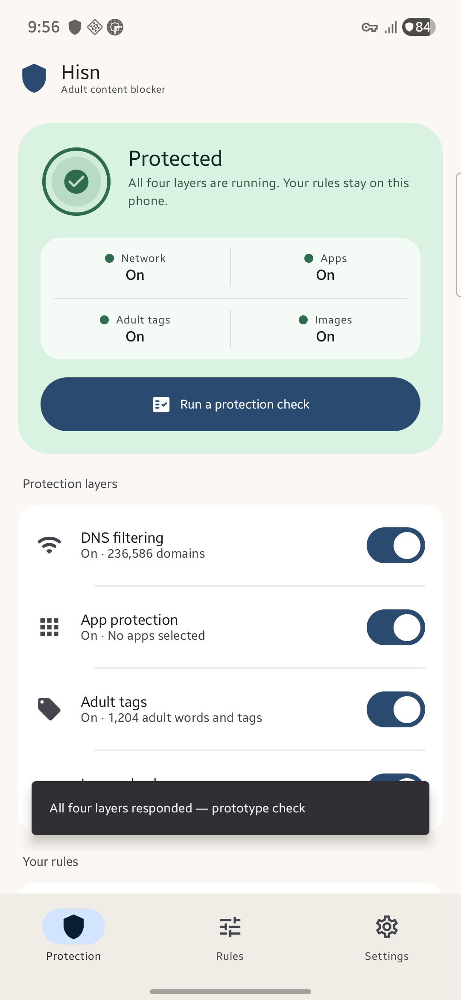 | 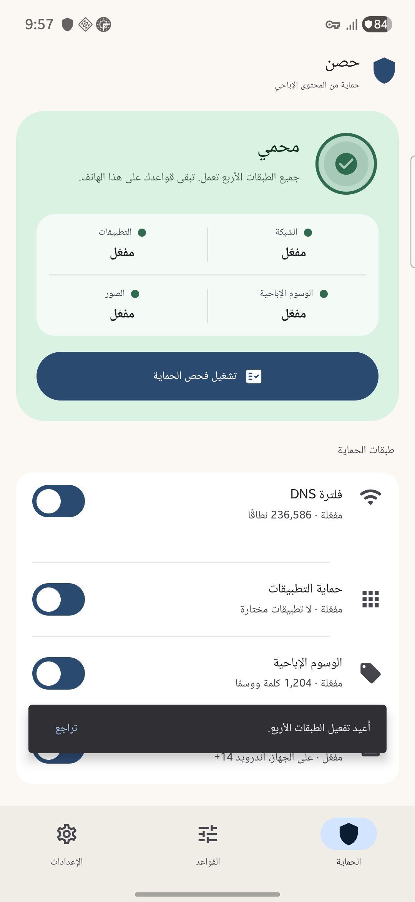 |

The theme sheet is a `ModalBottomSheet`, not a dialog: it drags, scrims and dismisses like the
platform picker. The row behind the swipe is a `SwipeToDismissBox` with the error container
and a real Undo; `animateItem` closes the gap. The pull indicator is Material's own
`PullToRefreshBox`, and the result is a snackbar above the navigation bar — not a Toast.
The Arabic capture is the same flow after tapping **إصلاح الثغرات**: the four layers arm
in sequence and the snackbar offers **تراجع**.

## Samsung device check

The prototype was installed on the owner's Galaxy S21 FE (`SM-G990B2`, API 36,
1080 × 2340, 420 dpi, system dark theme, **font scale 0.8**) as the separate package
`app.hisn.prototype`. Protection, Rules, Settings and the Arabic Protection screen all
render and scroll; no crash. The small font scale is a useful stress case — the rows
reflow instead of clipping.

| Samsung: Protection | Samsung: Arabic | Samsung: Rules |
| --- | --- | --- |
| 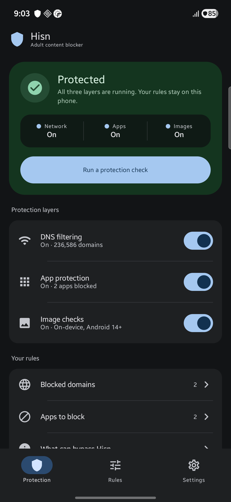 | 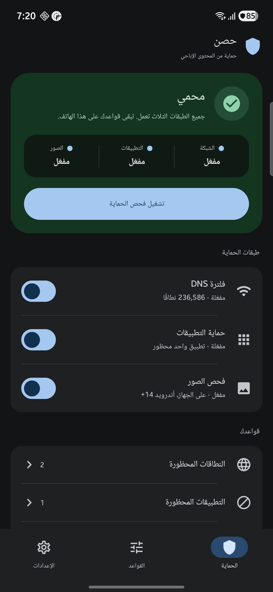 | 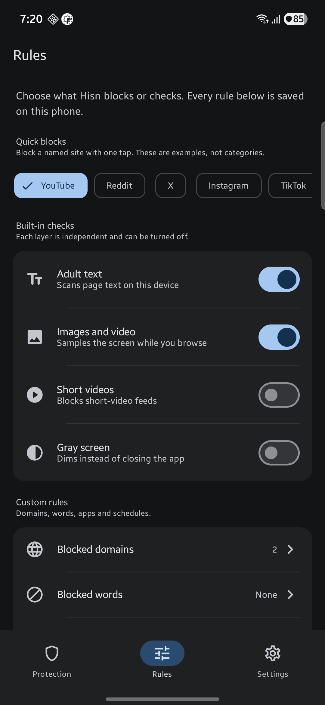 |

| Samsung: Apps detail | Samsung: partly protected |
| --- | --- |
| 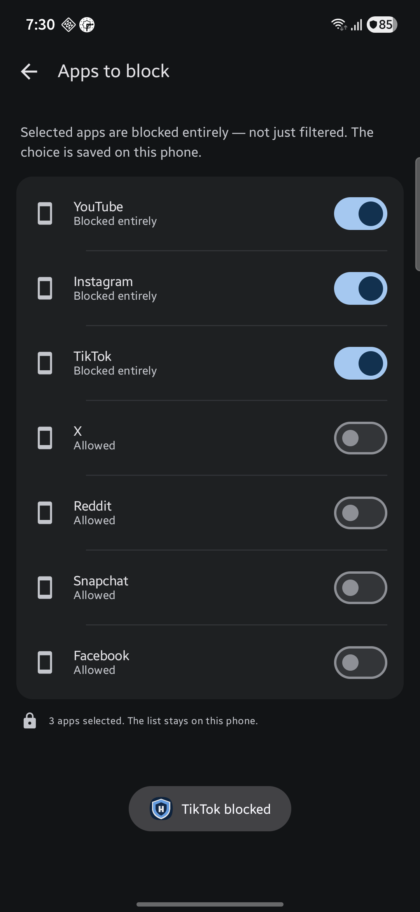 | 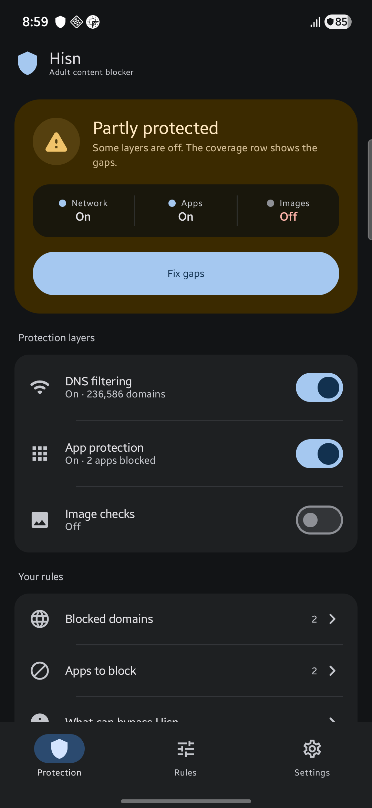 |

This is a UI check, not enforcement evidence. The prototype saves its own rules and reads
the phone's installed apps; it does not start the VPN, bind accessibility, or read
`PolicyStore`. The functional pass above was verified on the emulator (fresh install,
toggle round-trips, force-stop and relaunch) and then installed on the same Samsung.

## Design tokens

### Colour

| Role | Light | Dark |
| --- | --- | --- |
| Primary | `#2B4A6F` | `#A5C8F0` |
| On primary | `#FFFFFF` | `#12314F` |
| Primary container | `#D3E4FF` | `#2B4A6F` |
| Background / surface | `#FBF8F3` | `#121416` |
| Card (custom) | `#FFFFFF` | `#1E2022` |
| Surface container | `#F0EDE7` | `#1E2022` |
| On surface variant | `#45464D` | `#C4C6CC` |
| Outline | `#76777D` | `#8E9096` |
| Success | `#2E6B4F` | `#8FD3AE` |
| Success container | `#D9F2E2` | `#14351F` |
| Warning | `#7A5200` | `#F0C36A` |
| Warning container | `#FFE8C2` | `#3B2A00` |
| Error | `#BA1A1A` | `#FFB4AB` |
| Error container | `#FFDAD6` | `#93000A` |

The accent is still the old ink blue, warmed by the paper background. Body pairs are
≥ 4.5:1; status is always dot + word, never colour alone.

### Type

System sans (`FontFamily.SansSerif` → Roboto; Noto Sans Arabic fallback):

| Style | Size / line |
| --- | --- |
| Display small | 36 / 44 |
| Headline medium | 28 / 36 |
| Headline small | 24 / 32 |
| Title large | 22 / 28 |
| Title medium | 16 / 24 |
| Body large | 16 / 24 |
| Body medium | 14 / 20 |
| Label large | 14 / 20 |
| Label medium | 12 / 16 |
| Label small | 11 / 16 |

### Shape and spacing

4 dp grid. Screen gutter 16 dp; section gap 24 dp; card padding 16–20 dp; list row
minimum 56 dp; touch target 48 dp. Shapes: 4 / 8 / 12 / 16 / 28 dp. The hero is the
only 28 dp surface; buttons are full pills.

## Component map

| Old Hisn | New |
| --- | --- |
| Hand-built app bar with icon tile, serif title, overline | `TopAppBar` with title + tagline; logo only on home |
| Hand-built bottom nav with selected pill | `NavigationBar`; `NavigationRail` on wide screens |
| `LinearLayout` cards with hairline drawables | `Card` + `ListItem` on white `surfaceContainerLowest` |
| Serif page statement + tracked eyebrow | `headlineSmall` in a semantic hero; `titleSmall` section labels |
| Custom buttons with drawable backgrounds | `Button` / tonal buttons with Material state layers |
| Framework `Switch` tinted by theme | Material 3 `Switch` with a `toggleable` row |
| Custom chips | `FilterChip` with leading check |
| Status dots and tiles built by hand | Dot + word in a shared `LayerStat`; semantic containers |
| Custom dialogs | Material 3 `AlertDialog` for permission/minutes; `ModalBottomSheet` for Theme |

## What the prototype does not do

- It does **not** read or write `PolicyStore`, start the VPN, bind accessibility, read
  receipts, or enforce a lock. The numbers (`236,586`, `2 domains`, `1 app`) are
  placeholders.
- Rules and Settings are English in the prototype; only Protection has Arabic copy.
  Production `values-ar` already covers the rest.
- No Welcome, Shield/block page, pause flow, import/export, notifications, or
  device-owner screens were redesigned.
- No automated screenshot tests, TalkBack pass, or API 23 motion test. The reduced-motion
  path is implemented and the dynamic-color switch is wired; neither is covered by an
  automated capture.
- The prototype is `minSdk 26`; Hisn is `minSdk 23`. Compose supports 23, but the real
  port must be tested on API 23.

## Migration plan

The safe path is a strangler, not a big-bang rewrite. Enforcement stays in the existing
Java services and receivers; Compose only presents state and sends intents.

**Phase 0 — build setup.** In `android/app`, add the Compose plugin and the
stable Compose BOM. AGP 9.1.1 already has built-in Kotlin, so no `kotlin-android`
plugin is needed. Keep `minSdk 23`.

```groovy
// build.gradle (root)
plugins {
    id 'com.android.application' version '9.1.1' apply false
    id 'org.jetbrains.kotlin.plugin.compose' version '2.2.10' apply false
}

// app/build.gradle
plugins {
    id 'com.android.application'
    id 'org.jetbrains.kotlin.plugin.compose'
}

android {
    buildFeatures { compose true }
}

dependencies {
    implementation platform('androidx.compose:compose-bom:2026.09.00')
    implementation 'androidx.compose.material3:material3'
    implementation 'androidx.compose.ui:ui'
    implementation 'androidx.activity:activity-compose:1.13.0'
    debugImplementation 'androidx.compose.ui:ui-tooling'
}
```

**Phase 1 — shell and tokens (done, now the launcher).** Port `Theme.kt`, `Components.kt`, the top bar,
the bottom bar/rail and the crossfade. Put the new shell behind a debug flag so the existing
`MainActivity` remains the fallback until parity. The port landed in `android/nativeshell`
with sample content; see [the Phase 1 record](../../docs/ANDROID_NATIVE_SHELL_2026-11-11.md).

**Phase 2 — Protection.** Map the current status reads to an immutable
`ProtectionUiState` (layers, counts, receipts, next action) and render it. Wire actions
to the existing intents/services — `DnsVpnService`, `Permissions`, `LayerWatchdog`,
`TextGuardService`, `VisualGuard`. Do not move enforcement into composables.

**Phase 3 — Rules.** Every edit goes through `PolicyStore` and the existing validation;
the lock state makes the page read-only. Keep the confirmation dialogs and export/import
flows.

**Phase 4 — Settings/Guide, Welcome, Shield.** Port the remaining surfaces, then the
onboarding and block page. Use `values-ar` from the start; the prototype's Arabic copy
is only a visual reference.

**Phase 5 — evidence.** Screenshot tests on API 23 and 36, light/dark, 1.0×/1.3×/2.0×,
Arabic RTL, phone/tablet/foldable, TalkBack, and the existing core suite. Compare the
old and new screens before removing the fallback.

## Risks

- **APK/build cost.** Compose adds roughly 2–4 MB and build time. R8 and a single
  activity keep it bounded; the 9.8 MB TFLite model is still the larger asset.
- **State duplication.** The current UI refreshes every 2 s. A Compose state holder must
  own that loop or subscribe to it; two loops would race.
- **`minSdk 23`.** Compose supports it, but the UI must be exercised on an API 23
  emulator/device, especially insets and predictive back.
- **Dynamic color** can dilute the brand. It is opt-in, default off.
- **Material 3 Expressive APIs** are still moving. Pin versions; the prototype uses the
  stable Material 3 1.4.0 surface, not experimental expressive components.
- **Big-bang rewrite.** The current UI is functional and audited. The phased path keeps
  the old activity available until the new one passes the same checks.

## Run the prototype

```sh
cd design/android-native-2026-11-11/prototype
JAVA_HOME="/Applications/Android Studio.app/Contents/jbr/Contents/Home" \
  ANDROID_HOME="$HOME/Library/Android/sdk" \
  ./gradlew :app:assembleDebug
adb install -r app/build/outputs/apk/debug/app-debug.apk
adb shell am start -n app.hisn.prototype/.MainActivity
```

Intent extras used for the captures:

```sh
# tab: 0 Protection, 1 Rules, 2 Settings
adb shell am start -n app.hisn.prototype/.MainActivity --ei screen 0

# attention state, dark, Arabic, forced RTL
adb shell am start -n app.hisn.prototype/.MainActivity --ei screen 0 --ez attention true
adb shell am start -n app.hisn.prototype/.MainActivity --ei screen 0 --ez dark true
adb shell am start -n app.hisn.prototype/.MainActivity --ei screen 0 --ez arabic true
adb shell am start -n app.hisn.prototype/.MainActivity --ei screen 0 --ez rtl true

# detail route without tapping: domains, words, apps, schedule, limit, limit:apps,
# lock, permissions, diagnostics, wordtester, info:about, info:how, info:bypass
adb shell am start -n app.hisn.prototype/.MainActivity --es detail domains
```

The captures were taken on a Pixel 7 AVD at 1080 × 2400, 420 dpi, Android 16 (API 36),
a 2560 × 1600 tablet configuration at 320 dpi, and a Galaxy S21 FE (SM-G990B2, API 36,
font scale 0.8). Large text used `font_scale 1.3`.

## Sources

- [pick-ui-library](https://github.com/emilkowalski/skills/tree/main/skills/pick-ui-library) — web-only list; not used for the Android stack.
- [android/skills](https://github.com/android/skills) — the official Android skills collection; the native counterpart to the web-only list.
- [Material 3 motion](https://m3.material.io/styles/motion/overview/specs) and [Expressive motion theming](https://m3.material.io/blog/m3-expressive-motion-theming) — the spring and effects scheme the tokens follow.
- [Compose animation quick guide](https://developer.android.com/develop/ui/compose/animation/quick-guide) and [item animations](https://developer.android.com/develop/ui/compose/lists#item-animations) — `AnimatedContent`, `animateItem` and the spring defaults.
- [Predictive back](https://developer.android.com/guide/navigation/custom-back/predictive-back-gesture) — the Activity API used for the detail push; Android 16 enables it at target 36.
- [Haptic feedback](https://developer.android.com/develop/ui/views/haptics/haptic-feedback) and [`HapticFeedbackType`](https://developer.android.com/reference/kotlin/androidx/compose/ui/hapticfeedback/HapticFeedbackType) — ToggleOn/Off, Confirm, Reject and SegmentTick.
- [Android 16 behavior changes](https://developer.android.com/about/versions/16/behavior-changes-16) — edge-to-edge, predictive back and large-screen rules that shaped the shell.
- [Android UI development is Compose-first](https://android-developers.googleblog.com/2026/05/android-ui-development-is-compose-first.html) — the 2026 platform direction.
- [Material Components for Android is in maintenance mode](https://github.com/material-components/material-components-android) — why the redesign is Compose, not Views.
- [Compose Material 3](https://developer.android.com/develop/ui/compose/designsystems/material3) and [Material 3 releases](https://developer.android.com/jetpack/androidx/releases/compose-material3) — stable 1.4.0, November 2026.
- [Material 3 guidelines](https://m3.material.io) and [Material Theme Builder](https://material-foundation.github.io/material-theme-builder/) — colour roles and tonal palette.
- [Adaptive layouts in Compose](https://developer.android.com/develop/ui/compose/layouts/adaptive) — rail/window-size classes.
