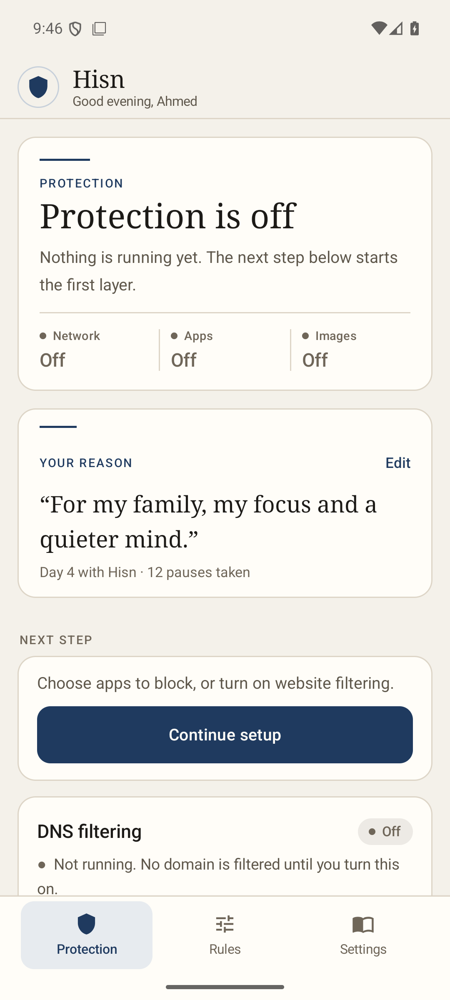
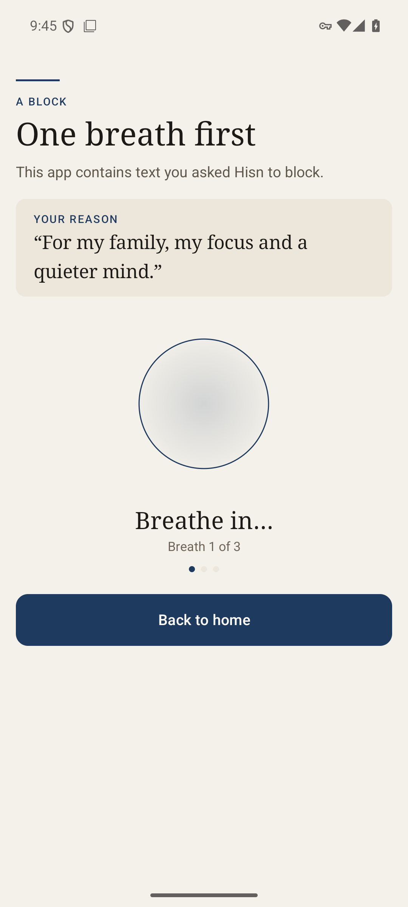
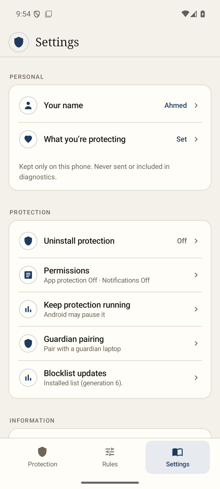
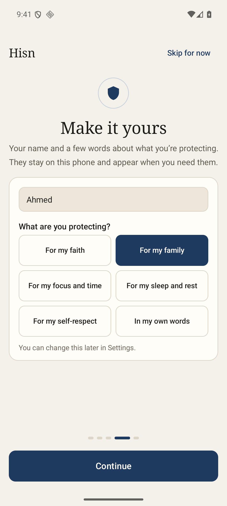
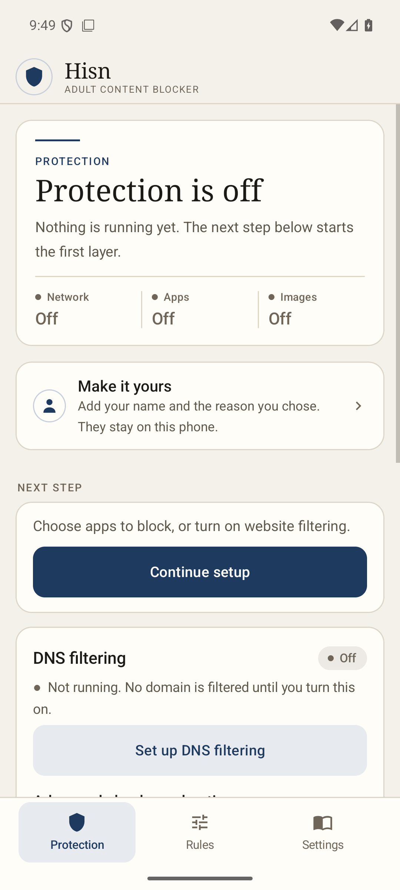
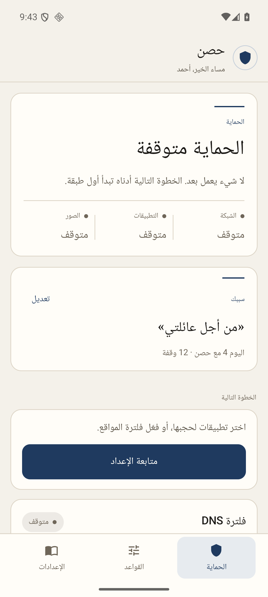
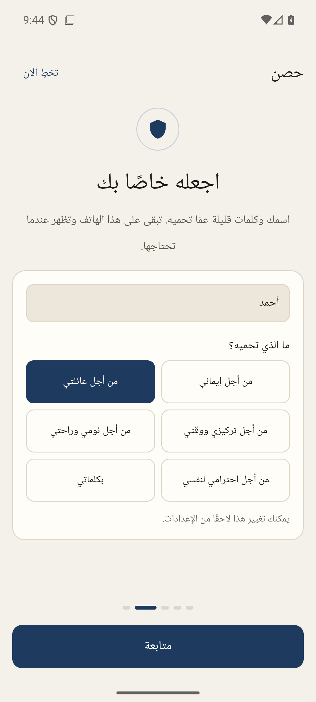
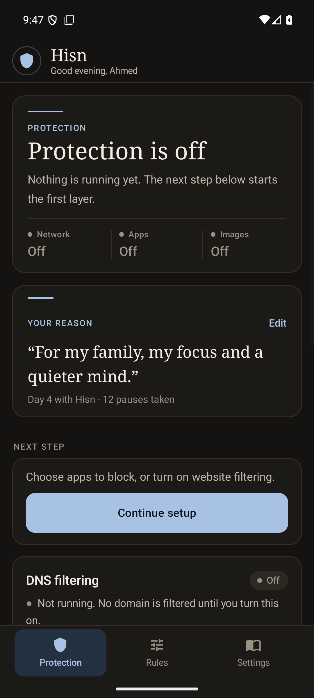
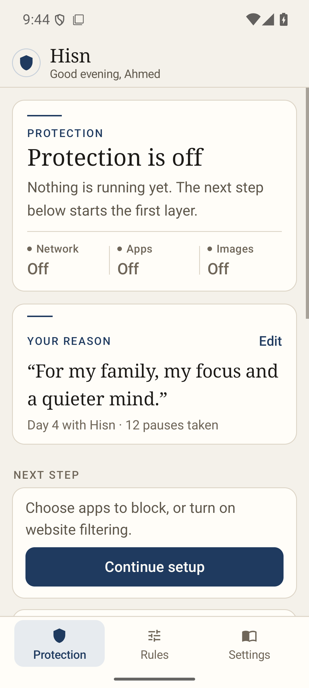

# Hisn Android: a personal layer

**Status: development captures, 11 November 2026.** These screenshots come from
the debug build of `android/app` (`app.hisn.android`, version 1.6.0 / 43) on the
API 36 emulator, not from a signed release or a phone. The local profile
(**Ahmed**, a custom reason, day 4, 12 pauses) was seeded before the captures;
the pause screen was opened through the debug restriction fixture. The Android
status bar shows the emulator's own icons.

| Protection, saved reason | A block remembers why | Settings › Personal |
| --- | --- | --- |
|  |  |  |

The greeting replaces the tagline only when a name is saved. The reason card
sits below the attention list, and its **Day 4 with Hisn · 12 pauses taken**
line counts local calendar days and counted pause screens, not clean days. The
pause screen shows the same words above the breathing circle. The Settings rows
open one editor; its window is `FLAG_SECURE`, so a capture of it is intentionally
blank.

| Welcome › Make it yours | Cold state, nothing saved |
| --- | --- |
|  |  |

The welcome page is optional and skippable. A name can be saved without a reason;
the Protection card then asks only for the missing reason. The editor accepts a
preset or the person's own words.

| Arabic, protection | Arabic, welcome |
| --- | --- |
|  |  |

The Arabic captures use the built-in **For my family** reason and the name
**أحمد**. The navigation, card edge, edit target, quotes and day line follow the
RTL layout; the two-column reason grid keeps every Arabic label visible without a
hidden horizontal scroll.

| Dark theme | Large text (1.3×) |
| --- | --- |
|  |  |

Both use the same card and semantic colours as the light theme. The large-text
capture reflows the quote and keeps the status and reason readable.

## What this proves, and what it does not

- It shows the feature renders in the production Android activity, not only in
  the Compose prototype in `design/android-native-2026-11-11/`.
- The name, reason, day and pause count stay in the app's `personal`
  `SharedPreferences` file. They are not a rule, are not part of the protection
  lock, and are not sent, exported or included in diagnostics.
- The editor is secure by design, so its screenshot is blank; its controls were
  checked through the accessibility tree instead.
- There is no physical-phone, TalkBack, rotation/process-death, signed-APK or
  native-speaker review here. The test scope and counts are in
  [the personal-layer note](../../docs/ANDROID_PERSONAL_2026-11-11.md).
