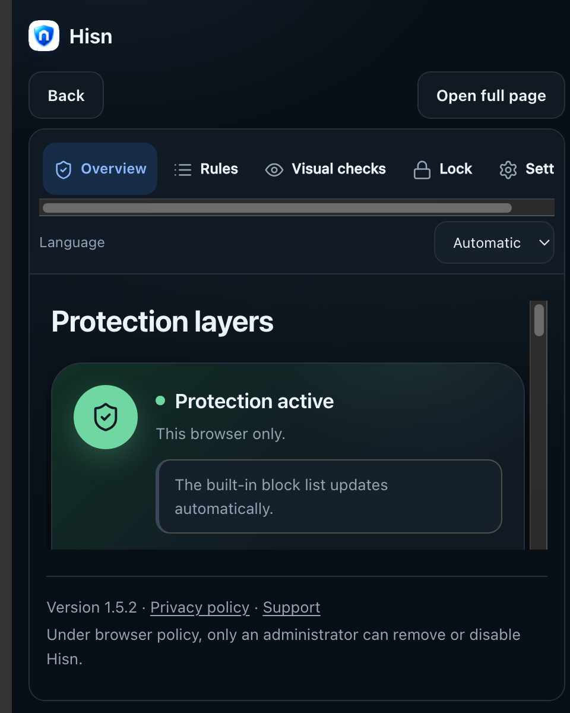
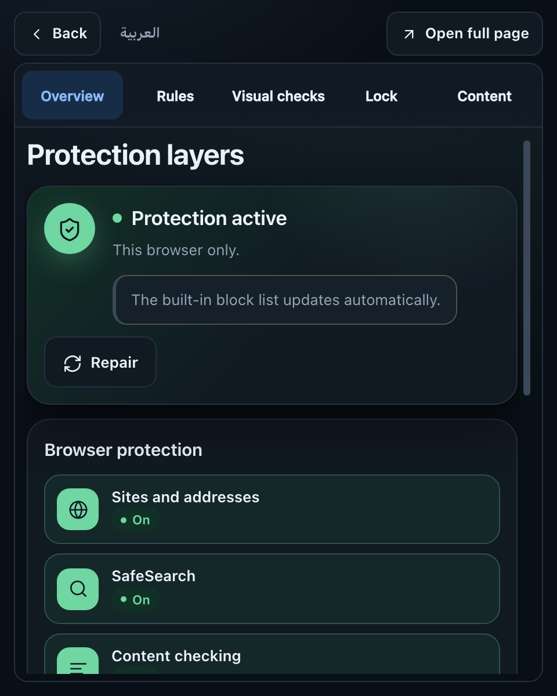

# Popup and embedded-settings UX — 6 November 2026

A focused pass over the extension's smallest surface: the toolbar popup and the
settings page it embeds. The protection model, message handlers, storage,
permissions, lock rules and the desktop settings page are unchanged.

The starting point was a report with a 480×600 popup in settings mode: five
tabs clipped after "Lock", a horizontal scrollbar under them, a language row
and a pinned footer eating the height, and a blue focus ring drawn around a
content area that was already cut off. Rebuilding that exact surface in the
preview harness showed why: the popup was rendering a desktop dashboard inside
a frame that had already spent more than half its height on popup header,
Back/Open-full-page bar, dashboard sidebar and footer.

## What changed

- **The popup's status render is whole again.** A reference error introduced
  when 1.5.1 deleted the private-window row left `badge` and `appLevel`
  undefined. The rejection happened after the hero was painted, so the Hisn-app
  row stayed on "Checking…", the lock strip rendered as an empty amber bar, and
  the notices and Details never appeared. The app row now paints its indicator
  and its word from the same connection state again.
- **The editor owns the popup while it is open.** The duplicate brand header is
  gone; one 38 px bar carries Back, the language switch and Open full page, and
  the frame gets 456×534 instead of about 456×470.
- **Five tabs fit one row.** Icons are omitted in the embedded tab row, the
  five sections share the width equally, and labels may wrap to two lines
  rather than disappear. A 3-column fallback wraps the row below 360 px.
- **Furniture that only makes sense on the full page is gone.** The embedded
  page no longer shows its language row, pinned footer or the three
  shortcut tiles that repeat the tab row. The full-page settings keep all of
  them.
- **The page gets the height.** Sidebar 130 px → 55 px, no footer, compact page
  padding and a compact status card; the scrollable page area is about 461 px
  instead of roughly 270 px in the same popup.
- **No clipped focus ring.** Focusing the scroll region no longer paints
  Chrome's focusable-scroller ring around the whole page.
- **Language is still one tap away.** The compact bar carries the same
  "العربية / English" switch as the status header; the embedded page follows
  the saved choice.
- **The ambiguous "Settings" tab is now "Content"**, matching the "Content
  options" page it opens.

## Screenshots

These are isolated previews with a mocked extension bridge at 480×600
(2× device pixels), not a real toolbar popup or a personal browser profile.
The before capture is the same surface rebuilt from the 1.5.2 checkout with
the same harness; the report itself came from an installed 1.4.0 build.

| Before | After |
| --- | --- |
|  |  |

Additional after captures:

| Capture | File |
| --- | --- |
| Status, dark | [after-popup-status-dark-en.png](after-popup-status-dark-en.png) |
| Status, light | [after-popup-status-light-en.png](after-popup-status-light-en.png) |
| Status, Arabic | [after-popup-status-ar.png](after-popup-status-ar.png) |
| Active lock | [after-popup-lock-dark-en.png](after-popup-lock-dark-en.png) |
| App offline | [after-popup-app-offline-dark-en.png](after-popup-app-offline-dark-en.png) |
| App connected | [after-popup-app-connected-dark-en.png](after-popup-app-connected-dark-en.png) |
| Repair state | [after-popup-repair-dark-en.png](after-popup-repair-dark-en.png) |
| Overview, dark | [after-settings-overview-dark-en.png](after-settings-overview-dark-en.png) |
| Overview, light | [after-settings-overview-light-en.png](after-settings-overview-light-en.png) |
| Overview, Arabic | [after-settings-overview-ar.png](after-settings-overview-ar.png) |
| Rules | [after-settings-rules-dark-en.png](after-settings-rules-dark-en.png) |
| Visual checks | [after-settings-media-dark-en.png](after-settings-media-dark-en.png) |
| Lock | [after-settings-lock-dark-en.png](after-settings-lock-dark-en.png) |
| Content options | [after-settings-content-dark-en.png](after-settings-content-dark-en.png) |

## Verification

- `extension/test/browser/run.sh popup.html` — PASS, including a new check that
  the popup script raises no error or unhandled rejection in any tested state,
  that the app row paints its icon and word together, that the editor hides the
  popup header and gives the frame 456×534, that focus starts on Back and
  returns to Manage protection, and that the editor's language switch works.
- `extension/test/browser/run.sh embedded.html` — PASS: five tabs inside the
  452 px row at a comfortable height, no horizontal overflow in English or
  Arabic, footer/language row/shortcut tiles hidden, a 461 px page area, the
  Repair action visible without scrolling, no focus ring on the scroll region,
  every section opens, and the 360 px fallback wraps instead of clipping.
- `extension/test/run.sh` — all JavaScript suites pass.
- `extension/test/browser/run.sh settings.html` remains timing-sensitive in
  this harness on a loaded machine (the file-import scenarios fail on some runs
  with the same files restored); the failures are recorded rather than hidden.

## Limits

- The captures use a mocked bridge and a preview page, not the real toolbar
  popup. Chrome's popup sizing, OS overlay scrollbars, high zoom and every
  browser theme were not exercised.
- The embedded page is still a scrollable dashboard; it is now readable and
  navigable at 480×600, not turned into a separate compact UI.
- No user study, screen-reader audit or physical-device review was run.
- The screenshots contain no browsing history or personal data; `example.test`
  is a fixture.
