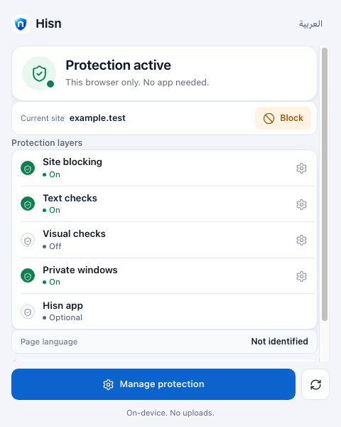
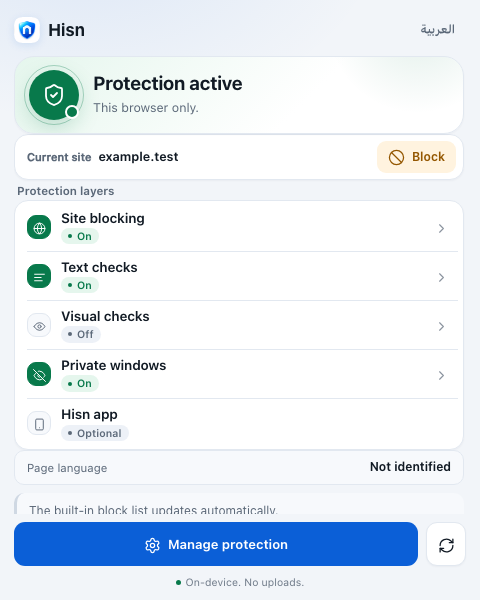
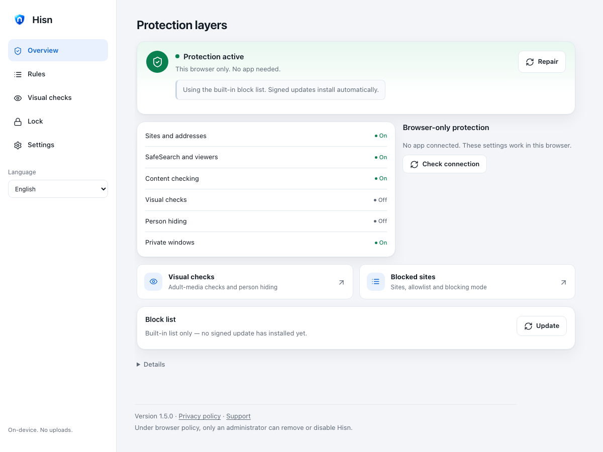
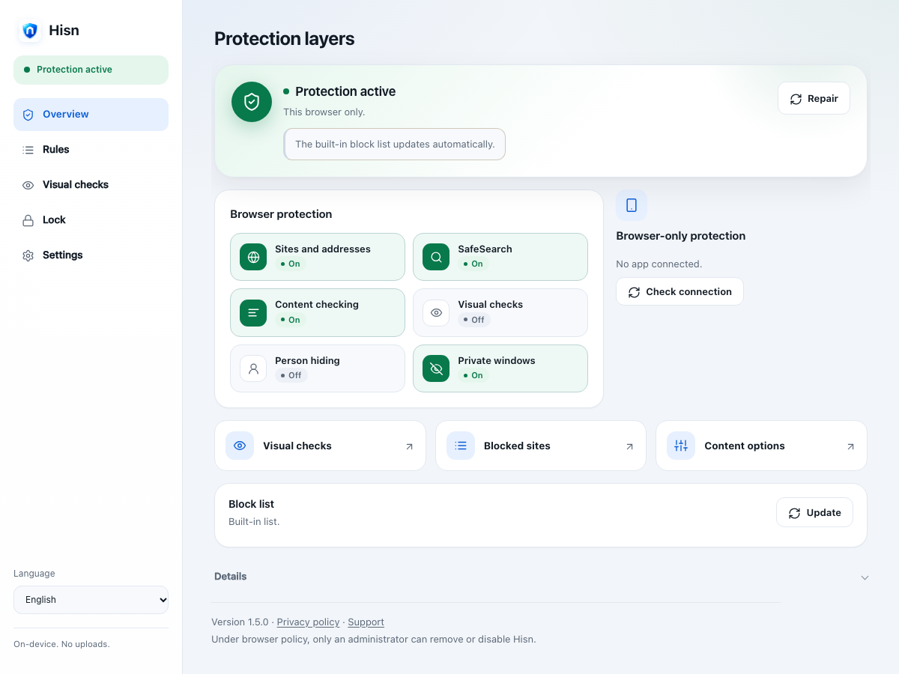
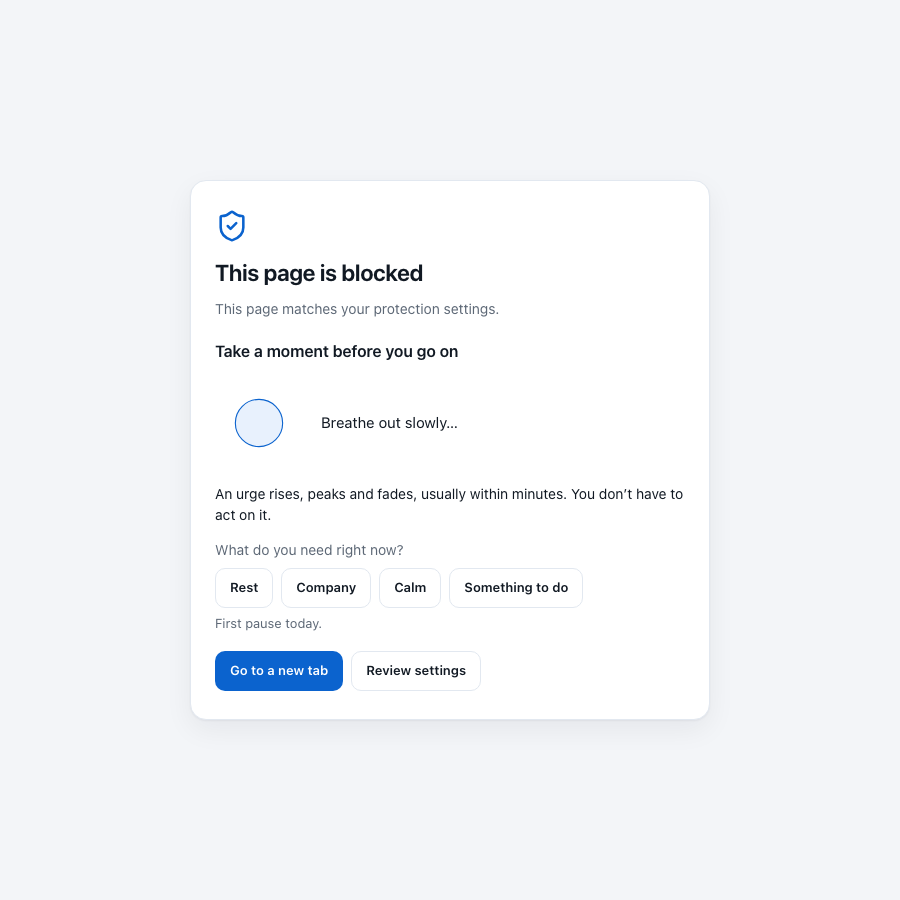
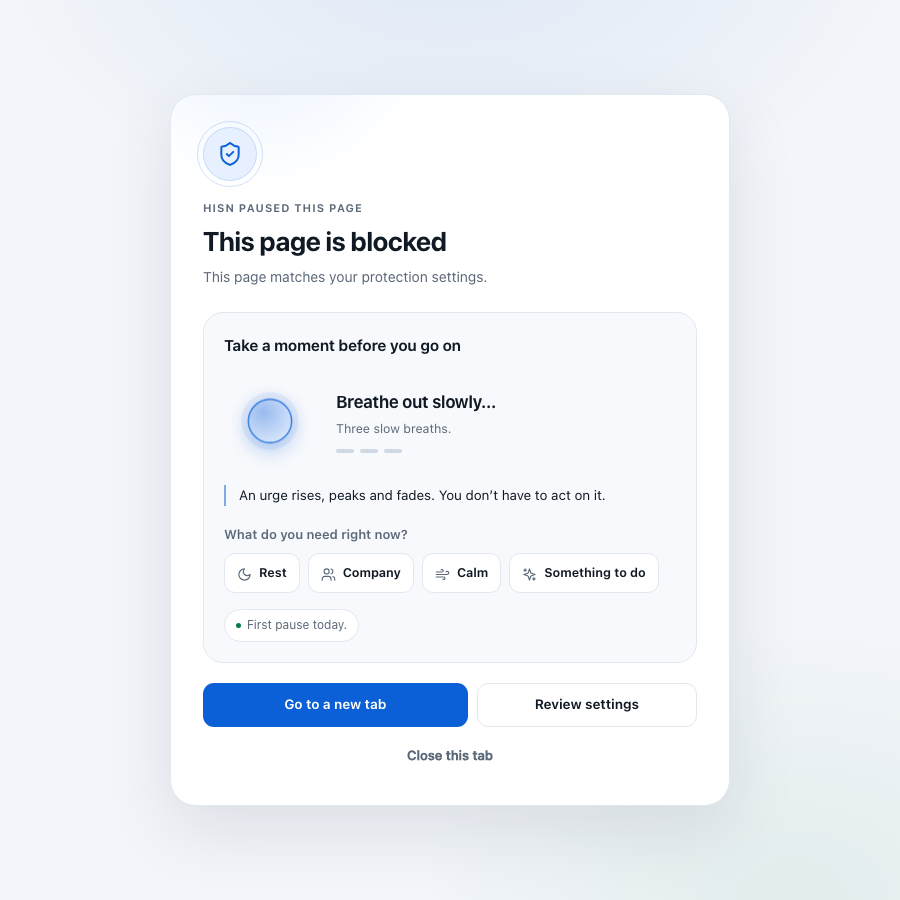

# Extension UI refresh — 4 November 2026

A visual and interaction pass over the Chromium extension's three surfaces:
the toolbar popup, the full settings dashboard, and the block page. The
protection model, message handlers, storage, permissions and lock rules are
unchanged.

## What changed

- **One calm visual system.** Softer layered surfaces, a restrained radial
  background, a single radius/shadow scale, and state-tinted status heroes.
  Green still means active, amber attention, blue action, red failure.
- **Popup.** The status hero now carries a tinted halo and a status bead.
  Each protection layer has its own icon (site, text, visual, private window,
  app) instead of five identical shields. Layer state is a compact pill, and
  the gear affordance is a chevron. The five layers still fit above the fold
  at the 480×600 popup size.
- **Settings dashboard.** A persistent status pill in the sidebar keeps the
  one-sentence protection state visible on every page. The overview is now a
  status hero, a six-tile protection grid, an app-connection card, three
  action shortcuts, the block-list card and a details disclosure.
- **Rules.** Mode is a pair of descriptive choice cards. The site editors have
  a clearer add/search/count hierarchy and a globe marker per host.
- **Content options.** Checkboxes became switches; the sensitivity control is
  a single grouped row with a value badge.
- **Visual checks.** Cards now have icons and a clear header. The appearance
  choices use a full-width legend and a 2×2 choice grid, stacking to one column
  below 520 px; fine-tuning lives inside the person card, with the three selects
  aligned in one row on wide screens.
- **Lock.** A single lock hero instead of a bare heading and paragraphs.
- **Block page.** A full-bleed calm field around one elevated card:
  - a "Hisn paused this page" eyebrow, a large shield mark, and the reason;
  - the pause panel is the centrepiece, with a glowing breathing orb, a
    three-breath progress strip, the rotating reminder, the four needs with
    icons, and the local pause tally;
  - one primary exit ("Go to a new tab"), a secondary settings action, and a
    quiet "Close this tab" link;
  - the correction/report section is a collapsed disclosure;
  - reduced motion keeps the orb still and hides the halo.
- **Less copy.** Page subtitles, shortcut descriptions and the long language
  list are gone. Long hints, block reasons and pause reminders were shortened;
  the block page now carries one short reminder and one short breath cue.
- **Arabic and RTL.** All new copy has Arabic; logical properties and mirrored
  chevrons keep the layout RTL-correct. The new labels were checked in the
  Arabic preview and the settings suite's Arabic viewport checks.

## Screenshots

The captures below are isolated previews with a mocked extension bridge, not a
real toolbar popup or a personal browser profile. They are design evidence, not
coverage or enforcement evidence.

| Before | After |
| --- | --- |
|  |  |
|  |  |
|  |  |

Additional after captures: [Arabic popup](after-popup-light-ar.png),
[Arabic overview](after-options-overview-ar.png),
[Rules](after-options-rules.png), [Visual checks](after-options-media.png),
[Content options](after-options-settings.png),
[Arabic content options](after-options-settings-ar.png), and
[Arabic block page](after-blocked-ar.png). Real-worker captures:
[dark popup](after-popup-dark-en.png), [dark Arabic popup](after-popup-dark-ar.png),
[dark overview](after-options-overview-dark-en.png),
[dark rules](after-options-rules-dark-en.png),
[dark content options](after-options-settings-dark-en.png),
[dark lock](after-options-lock-dark-en.png) and
[dark block page](after-blocked-dark-en.png). Narrow captures:
[Arabic overview](after-options-overview-narrow-ar.png),
[visual checks](after-options-media-narrow.png) and
[block page](after-blocked-narrow.png) at 390 px width.

## Verification

- `extension/test/run.sh` — all JavaScript suites passed, including the
  English/Arabic key-and-placeholder parity test.
- `extension/test/browser/run.sh popup.html` — passed.
- `extension/test/browser/run.sh blocked.html` — passed.
- `extension/test/browser/run.sh settings.html` — passed on a clean run. The
  file-import checks are timing-sensitive in this harness and failed on some
  runs with the same files restored to the pre-change versions; this is
  recorded rather than hidden.
- A real-worker Playwright run in Helium loaded the unpacked extension,
  verified the baseline and repair readback, and captured the dark English and
  dark Arabic popup, dark overview, rules, content options, lock and block page.
  The visual-checks page was not captured because Helium reports the local
  visual engine as `unsupported-runtime`; branded Chrome 156 refused to load
  the unpacked extension, so the full `ui-qa.cjs` actual-toolbar scenario did
  not run.
- No user study, screen-reader audit or physical-device review was run.

## Research input

The design pass used the project's existing REA practice. See
[the research note](../../docs/EXTENSION_UI_REFRESH_2026-11-04.md) for evidence
identifiers, what was observed in ScreenZen, and what was deliberately not
copied.
