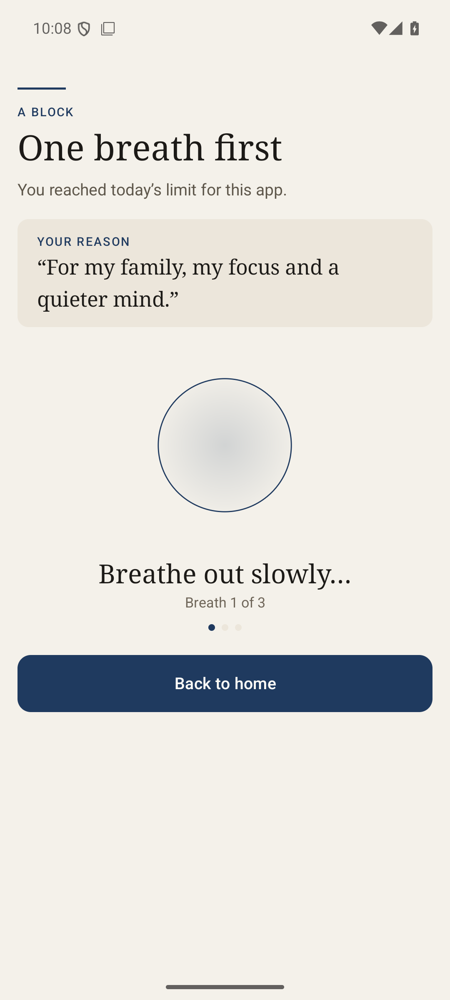

# Android daily time limits, set per app — 2026-11-11

The **Daily time limits** editor asked for apps and then applied one minutes
value to all of them. `AppTimeLimit` already stored a value per package and
`TextGuardService` already enforced per app, so the gap was the editor only.
The dialog now gives each chosen app its own limit.

No permission, model, storage format or enforcement rule changed: the dialog
still writes `AppTimeLimit(package=minutes)` and the guard still asks
`exceeded(package, usedToday)`. The direct build stays 1.6.0 (versionCode 43).

## What changed

- `MainActivity.editTimeLimits()` keeps a `package → minutes` map instead of a
  single `int[]`. A newly picked app starts at 15 minutes (the old shared
  default); removing an app drops its value.
- Each app is a `SettingRow`: app label, **Used X of Y today** from Android's
  own usage record, a progress bar, and the app's limit on the trailing edge.
  Tapping the row opens **Daily limit for \<app\>** with 5 min, 15, 30, 1 h,
  2 h, 4 h, 8 h and 24 h.
- Saving builds the map from the current selection. The Rules row keeps
  `N apps with daily limits · 60 min per day` when every value matches, and
  says `N apps with daily limits · limits set per app` when they differ
  (new `time_limits_summary_mixed`, English and Arabic).
- `time_limits_help` and `time_limits_limit_title` were reworded for per-app
  limits. `android/check-strings.py` passes (707 strings, 19 plurals,
  700 references, English and Arabic).

## Verification

Emulator (API 36, debug build from this tree, Android Usage access granted):
Calendar, Chrome, Gmail and YouTube were added, Chrome set to 5 min and
Calendar to 1 h. The dialog then showed `Used 0 min of 1 h today` beside
`Used 1 min of 5 min today`, the Rules row read
`2 apps with daily limits · limits set per app`, and the values survived a
force-stop and relaunch.

Enforcement was observed end to end: YouTube was used past its 5-minute limit
and Hisn's guard closed it to the restriction screen on the next launch —
**One breath first · You reached today's limit for this app.** After YouTube was
removed from the list, the app opened normally again, so the block came from
the saved per-app value rather than a stuck state.

The owner's Galaxy S21 FE (`SM-G990B2`) was updated in place to
**1.6.0-direct (versionCode 43)**, signed with the same release key as the
installed 1.5.4-direct, so saved rules and the lock survived the update. A
protection lock was running, so the editor could not be exercised on the phone;
the new strings were confirmed inside the installed APK with `aapt2 dump
strings`. Samsung dropped Hisn's accessibility binding on the update; it was
re-enabled and verified bound afterwards.

`android/test-core.sh` passes after the change.
