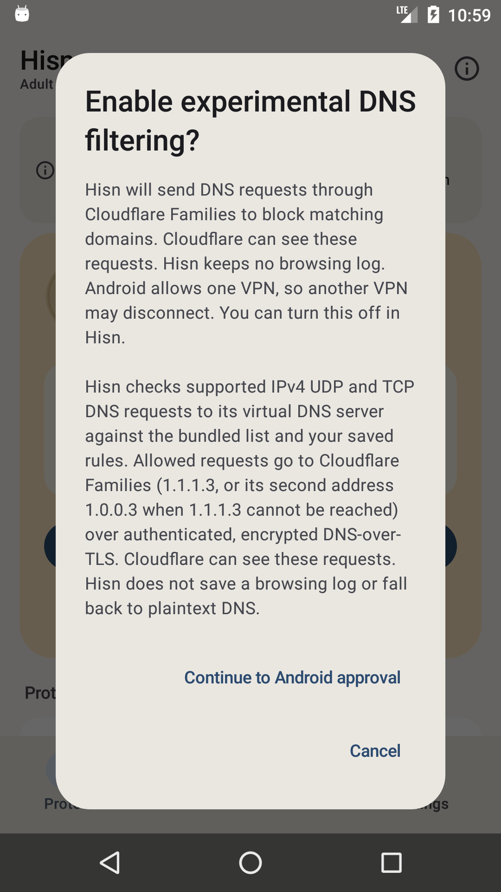
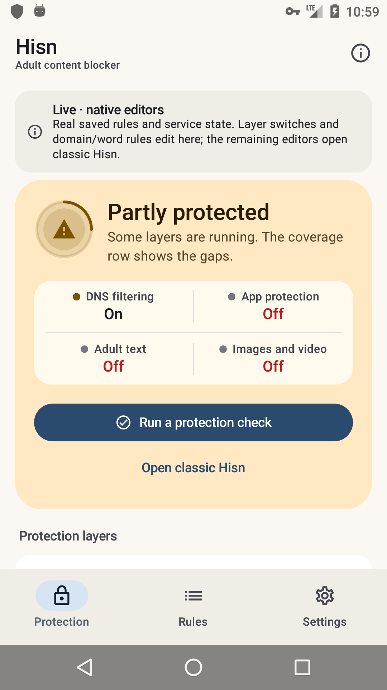

# Android: the native shell, Phase 4

**Status: development, debug-only, 11 November 2026.** The native shell can now set up the real
DNS layer: disclosure, notification permission, Android's VPN approval, the existing foreground
service and the live status refresh. The classic launcher remains the default; app selection,
schedule, limits, the protection lock, Welcome and Shield are still classic. Nothing here is in a
release APK.

Phase 2 made the shell read real state. Phase 3 added native layer switches and the domain/word
editor. Phase 4a closes the first **service** action, using the same consent text and the same
`DnsVpnService` the classic screen starts.

## What landed

- **Native DNS setup.** When DNS is off, the Protection hero's primary action is **Set up DNS
  filtering**. It opens the real disclosure; accepting requests the Android 13+ notification
  permission, then launches `VpnService.prepare`, and starts the existing
  `DnsVpnService` after approval. The shell polls and turns the hero into *Partly protected* /
  *On* when the tunnel reports running.
- **Nothing is reimplemented in the shell.** The host uses the app's `DnsVpnService`,
  `Compat.startForegroundService` and the same consent strings. Cancel and denial leave the app
  unchanged; a stale UI cannot start the tunnel without Android's approval.
- **Correct app identity.** The application label stays **Hisn** (the VPN consent dialog reads
  it); the classic launcher is labelled **Hisn (classic)** and the native launcher **Hisn
  Native**. A release build keeps the ordinary single **Hisn** launcher.
- **The banner is current.** It says layers, domain/word rules and DNS setup are native; apps,
  schedule, limits and the lock still open classic Hisn.

## What the shell shows

| Native DNS disclosure | DNS running, partly protected |
| --- | --- |
|  |  |

The second capture is the result of the real flow on the API 23 emulator: the system VPN dialog
was approved, `DnsVpnService` started, and the hero's coverage row moved to **DNS filtering On**
with the other three layers still off. The key icon in the status bar is Android's VPN indicator.

## What it does not do yet

- **No DNS stop.** The app has no in-app DNS stop API; Android's VPN settings / revoke is still
  the way out, and the shell says nothing else.
- **No native app picker.** Adult text and image checks still ask the owner to choose apps in
  classic after enabling.
- **No schedule, daily limit, protection lock, uninstall protection, export/import or guardian
  editors.**
- **No Welcome, Shield/Restriction/pause or AfterBlock surfaces.**
- **No Arabic layout, TalkBack, screenshot-test or 2.0× font pass yet.** The host already
  returns Arabic strings.
- **The classic launcher remains the default; the classic UI is not deleted.**

## Build and run

`-PhisnNativeShell=true` uses the real application id so the shell sees the installed policy.
Use an emulator/test device, not the owner's release-signed install.

```sh
cd android
export JAVA_HOME="/Applications/Android Studio.app/Contents/jbr/Contents/Home"
export ANDROID_HOME="$HOME/Library/Android/sdk"

./gradlew :app:assembleDebug -PhisnNativeShell=true
adb install -r app/build/outputs/apk/debug/app-debug.apk
adb shell am start -n app.hisn.android/app.hisn.android.nativeshell.ShellActivity
```

A plain `assembleDebug` leaves the shell disabled and the ordinary Hisn launcher; a release build
does not link `:nativeshell` at all.

## Verification, 11 November

- API 23 emulator: tapped **Set up DNS filtering**, read the disclosure, accepted Android's VPN
  dialog, observed `DnsVpnService` start and the hero change to **Partly protected / DNS On**;
  the primary action then became **Run a protection check**. Also re-checked the Phase 3 adult
  toggle, saved domain, Android 14+ image message and open-classic/back flow.
- `./gradlew --no-daemon assembleDebug assembleDebugAndroidTest lintDebug assembleRelease` pass.
- `./gradlew :app:assembleDebug -PhisnNativeShell=true` passes.
- `android/test-core.sh`, `python3 check-strings.py` and `python3 script/test_docs.py` pass.
- Release APK still has zero `nativeshell`/Compose references.
- Manifest check: application label **Hisn**, MainActivity **Hisn (classic)** only in the native
  debug variant, ShellActivity **Hisn Native**.

## Next phases

1. **Phase 4b — app picker.** A real Compose picker over `PackageManager`, writing
   `blockedApps`/`scannedApps` through `PolicyStore`, with the same exclusions and validation.
2. **Phase 4c — schedule, time limits, protection lock.** Native editors for all three, including
   the lock's read-only consequences.
3. **Phase 5 — remaining surfaces.** Welcome, Shield/Restriction/pause, export/import, Arabic,
   TalkBack and screenshot tests; then flip the launcher and delete the classic dashboard.
