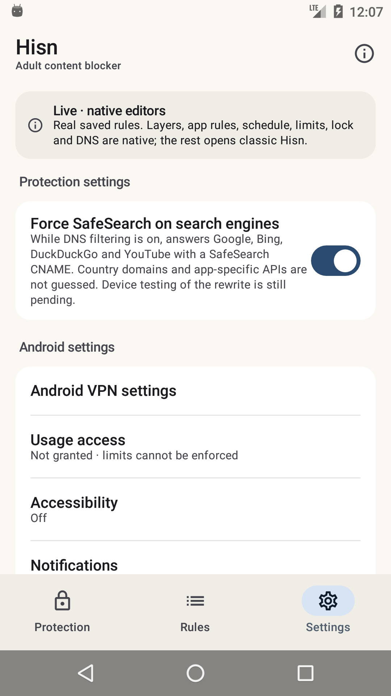

# Android: the native shell, Phase 4f

**Status: development, debug-only, 11 November 2026.** The native Settings screen is no longer a
read-only summary: it can change the real **SafeSearch** policy and open the relevant Android
settings surfaces. Uninstall protection, Welcome, Shield and the remaining surfaces are still
classic; the classic launcher remains the default and nothing here is in a release APK.

## What landed

- **SafeSearch is real.** The switch calls `PolicyStore.updateSafeSearch`, so the saved DNS
  preference, the protection lock and the store's refusal are exactly the classic ones. It shows
  the real `safeSearchEnabled()` value and is disabled during a protection lock; the host still
  enforces the refusal.
- **Native Android settings shortcuts.** VPN settings, Usage access, Accessibility and app
  Notification settings open their Android pages directly instead of sending the owner to the
  classic dashboard. Usage/Accessibility/Notifications show their live permission status.
- **The Settings page is a real screen.** Protection controls, Android settings and the
  pre-existing permission/language/version sections share the same Material 3 surface and the
  same 2-second live refresh while resumed.
- **Snapshot feedback.** The switch refreshes from `PolicyStore` after save; Android settings
  return to a refreshed permission summary.

## What the shell shows



The capture is a real API 23 state: SafeSearch on, Usage access not granted, Accessibility off,
with the native settings shortcuts below.

## What it does not do yet

- **No native uninstall-protection editor.** Its direct-build/device-owner controls and the
  provisioning command still open classic Hisn.
- **No native Welcome, Shield/Restriction/pause or AfterBlock surfaces.**
- **No native export/import or guardian editor.**
- **No Arabic layout, TalkBack, screenshot-test or 2.0× font pass yet.** The host already
  returns Arabic strings.
- **DNS stop** still does not exist in the app.
- **The classic launcher remains the default; the classic UI is not deleted.**

## Build and run

`-PhisnNativeShell=true` uses the real application id so the shell sees installed policy. Use an
emulator/test device.

```sh
cd android
export JAVA_HOME="/Applications/Android Studio.app/Contents/jbr/Contents/Home"
export ANDROID_HOME="$HOME/Library/Android/sdk"

./gradlew :app:assembleDebug -PhisnNativeShell=true
adb install -r app/build/outputs/apk/debug/app-debug.apk
adb shell am start -n app.hisn.android/app.hisn.android.nativeshell.ShellActivity
```

A plain `assembleDebug` leaves the shell disabled; `assembleRelease` does not link
`:nativeshell` at all.

## Verification, 11 November

- API 23 emulator: opened **Settings**, toggled **SafeSearch** on and saw the saved switch
  (checked state from the real policy); tapped **Usage access** and confirmed Android opened
  `com.android.settings/UsageAccessSettingsActivity`, then returned to the shell. `pm clear`
  reset the emulator data afterwards.
- `./gradlew --no-daemon assembleDebug assembleDebugAndroidTest lintDebug assembleRelease` pass.
- `./gradlew :app:assembleDebug -PhisnNativeShell=true` passes.
- `android/test-core.sh`, `python3 check-strings.py` and `python3 script/test_docs.py` pass.
- Release APK still has zero `nativeshell`/Compose references.
- Earlier phases re-checked across the stack: layers, apps, schedule, limits, DNS, lock and the
  classic fallback.

## Next phases

1. **Phase 4g — uninstall protection.** A native status/provisioning surface first, then the
   direct-build/device-owner controls with their real constraints.
2. **Phase 5 — remaining surfaces.** Welcome, Shield/Restriction/pause, export/import, Arabic,
   TalkBack and screenshot tests; then flip the launcher and remove the classic dashboard.
