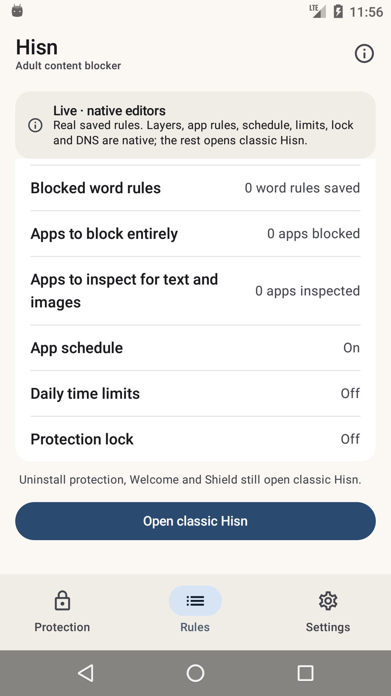

# Android: the native shell, Phase 4e

**Status: development, debug-only, 11 November 2026.** The native shell can now edit the real
**daily app schedule**: enabled state, days, one time window, block/keep mode and the app
selection. Uninstall protection, Welcome, Shield and the remaining surfaces are still classic;
the classic launcher remains the default and nothing here is in a release APK.

## What landed

- **Native schedule editor.** The Rules row opens a native sheet with the existing
  `DailyAppSchedule`: enable switch, start/end time buttons, Monday-first day chips, the
  block-only / block-everything-except mode, and a private app picker.
- **Native time entry.** Start and end use a Material 3 `TimeInput` dialog; the 22:00–07:00
  overnight default and arbitrary windows are preserved, and equal endpoints are refused by the
  core model/save path.
- **Real policy write.** Save calls `PolicyStore.updateSchedule(new DailyAppSchedule(...))`, so
  validation, the protection lock and the second store check stay in one place. The app picker
  preserves saved packages that are temporarily uninstalled; labels switch between *Apps to
  block* and *Apps to keep available* with the mode.
- **Exact refusals.** Equal times, zero days, enabling with no apps, and store refusals use the
  existing schedule strings instead of a generic error.
- **Lock-aware and private.** The schedule is read-only during a protection lock and the sheet is
  `FLAG_SECURE`; it is deliberately absent from screenshots.
- **The summary is live.** Rules changes the App schedule row from **Off** to **On** from the
  saved `DailyAppSchedule`; the remaining app rules, limits and lock stay independent.

## What the shell shows



The capture is a real API 23 state: a schedule enabled with **Browser** on **22:00–07:00**, all
days, in blocklist mode, beside the native daily limits and lock rows. The editor itself is
private (`FLAG_SECURE`), so the saved row is the evidence.

## What it does not do yet

- **No native uninstall-protection, export/import or guardian editors.**
- **No native Welcome, Shield/Restriction/pause or AfterBlock surfaces.**
- **No Arabic layout, TalkBack, screenshot-test or 2.0× font pass yet.** The host already
  returns Arabic strings.
- **DNS stop** still does not exist in the app.
- **The classic launcher remains the default; the classic UI is not deleted.**

## Build and run

`-PhisnNativeShell=true` uses the real application id so the shell sees installed policy. Use an
emulator/test device.

```sh
cd android
export JAVA_HOME="/Applications/Android Studio.app/Contents/jbr/Contents/Home"
export ANDROID_HOME="$HOME/Library/Android/sdk"

./gradlew :app:assembleDebug -PhisnNativeShell=true
adb install -r app/build/outputs/apk/debug/app-debug.apk
adb shell am start -n app.hisn.android/app.hisn.android.nativeshell.ShellActivity
```

A plain `assembleDebug` leaves the shell disabled; `assembleRelease` does not link
`:nativeshell` at all.

## Verification, 11 November

- API 23 emulator: opened **App schedule**, kept the 22:00–07:00 window, selected **Browser**,
  enabled the schedule, saved, and verified the Rules row **On**. Opened the start time and saw
  the native `TimeInput` dialog. `pm clear` reset the emulator data afterwards.
- `./gradlew --no-daemon assembleDebug assembleDebugAndroidTest lintDebug assembleRelease` pass.
- `./gradlew :app:assembleDebug -PhisnNativeShell=true` passes.
- `android/test-core.sh`, `python3 check-strings.py` and `python3 script/test_docs.py` pass.
- Release APK still has zero `nativeshell`/Compose references.
- Earlier phases re-checked across the stack: layer switches, domain/app editors, DNS start,
  daily limits and the protection lock.

## Next phases

1. **Phase 4f — uninstall protection.** Native switch/status over `UninstallProtectionController`,
  with the direct/dev-owner limits kept explicit.
2. **Phase 5 — remaining surfaces.** Welcome, Shield/Restriction/pause, export/import, Arabic,
   TalkBack and screenshot tests; then flip the launcher and remove the classic dashboard.
