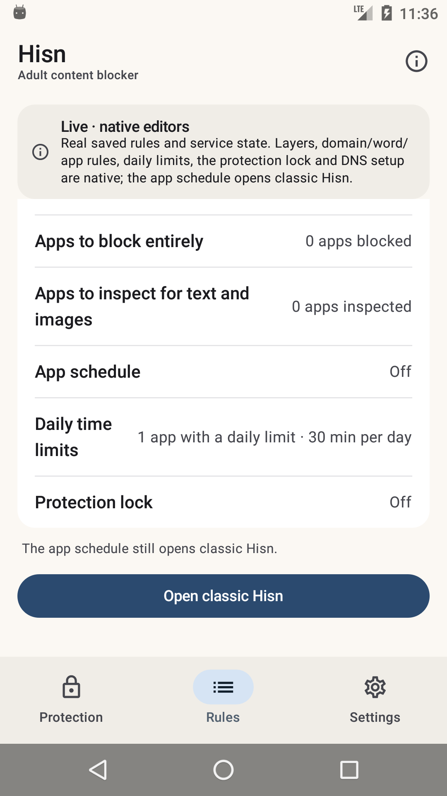

# Android: the native shell, Phase 4d

**Status: development, debug-only, 11 November 2026.** The native shell can now set per-app
**daily time limits**. The app schedule, Welcome, Shield and the remaining surfaces are still
classic; the classic launcher remains the default and nothing here is in a release APK.

## What landed

- **Native daily-limit editor.** The Rules row opens a native picker over the phone's launchable
  apps with search, icons, a selected count and a 200-app limit. Each selected app starts at 15
  minutes and has its own choice of **5, 15, 30, 60, 120, 240, 480 or 1,440 minutes**.
- **Real policy write.** Save constructs the core `AppTimeLimit` and calls
  `PolicyStore.updateTimeLimits`, so validation, the protection lock and the store's second check
  all stay in one place. Uninstalled saved apps keep their limit, matching the classic picker.
- **Usage access is visible and actionable.** The editor shows the real
  `Permissions.usage()` state, opens Android's Usage access screen, and after a save says
  *Daily limits saved. Grant Android Usage access so they can be enforced* when it is still
  missing. The enforcement itself stays in the existing accessibility/usage service.
- **The summary is live.** Rules changes from **Off** to *1 app with a daily limit · 30 min per
  day* (or the plural count), using the saved `AppTimeLimit`, not shell bookkeeping.
- **Private and lock-aware.** The editor takes `FLAG_SECURE` while open and is read-only during a
  protection lock; `PolicyStore.save` refuses a stale write as before.
- **Focus discipline.** The picker starts on the list, not the search field, so Save is not hidden
  by the keyboard.

## What the shell shows



The capture is a real API 23 state: **Browser** saved at **30 min per day**, while app blocking,
inspection, schedule and the lock are still their own states. The editor itself is private
(`FLAG_SECURE`) and deliberately absent from screenshots; the saved summary is the evidence.

## What it does not do yet

- **No native app schedule editor.** It still opens classic.
- **No native uninstall-protection, export/import or guardian editors.**
- **No Welcome, Shield/Restriction/pause or AfterBlock surfaces.**
- **No Arabic layout, TalkBack, screenshot-test or 2.0× font pass yet.** The host already
  returns Arabic strings.
- **DNS stop** still does not exist in the app.
- **The classic launcher remains the default; the classic UI is not deleted.**

## Build and run

`-PhisnNativeShell=true` uses the real application id so the shell sees installed policy. Use an
emulator/test device.

```sh
cd android
export JAVA_HOME="/Applications/Android Studio.app/Contents/jbr/Contents/Home"
export ANDROID_HOME="$HOME/Library/Android/sdk"

./gradlew :app:assembleDebug -PhisnNativeShell=true
adb install -r app/build/outputs/apk/debug/app-debug.apk
adb shell am start -n app.hisn.android/app.hisn.android.nativeshell.ShellActivity
```

A plain `assembleDebug` leaves the shell disabled; `assembleRelease` does not link
`:nativeshell` at all.

## Verification, 11 November

- API 23 emulator: opened **Daily time limits**, selected **Browser**, changed the default
  **15 min** to **30 min**, saved, and verified *1 app with a daily limit · 30 min per day* plus
  the Usage-access-needed message. Then `pm clear` reset the emulator data.
- `./gradlew --no-daemon assembleDebug assembleDebugAndroidTest lintDebug assembleRelease` pass.
- `./gradlew :app:assembleDebug -PhisnNativeShell=true` passes.
- `android/test-core.sh`, `python3 check-strings.py` and `python3 script/test_docs.py` pass.
- Release APK still has zero `nativeshell`/Compose references.
- Earlier phases re-checked across the stack: native DNS to **DNS On / Partly protected**,
  app pickers, domain editor, adult toggle, Android 14+ image message, lock read-only behaviour
  and open classic/back.

## Next phases

1. **Phase 4e — app schedule.** Native day/window/app editor over `PolicyStore.updateSchedule`,
   with the existing validation and lock consequences.
2. **Phase 5 — remaining surfaces.** Welcome, Shield/Restriction/pause, uninstall protection,
   export/import, Arabic, TalkBack and screenshot tests; then flip the launcher and remove the
   classic dashboard.
