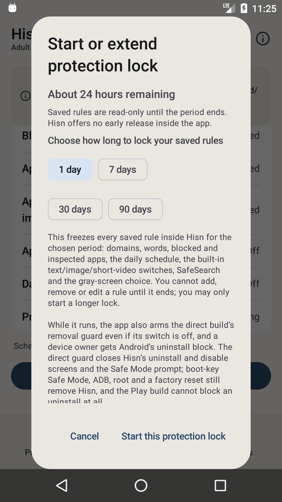
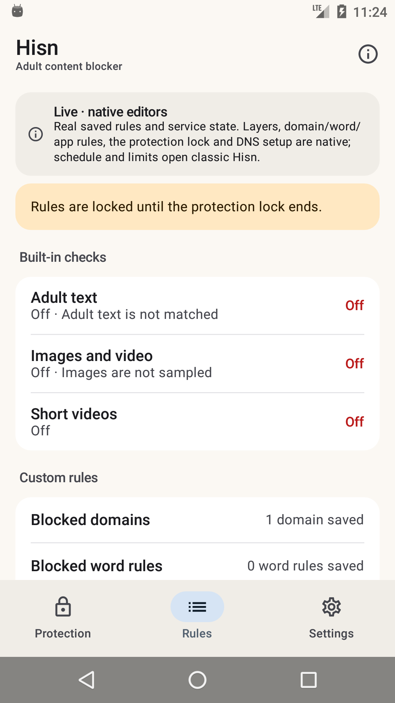

# Android: the native shell, Phase 4c

**Status: development, debug-only, 11 November 2026.** The native shell can now start and extend
the real **protection lock**. It shows the full commitment disclosure, the 1/7/30/90-day periods,
the remaining time, the read-only banner and the same guard side effects as the classic
confirmation. Schedule and daily limits remain classic. The classic launcher is still the
default; nothing here is in a release APK.

## What landed

- **Native protection lock.** The Rules row opens a native sheet with the real disclosure and
  period chips. Starting writes through `PolicyStore.startCommitment`, arms the direct-build
  removal guard and boot mirror (`UninstallProtectionController.sync`,
  `BootShieldService.mirror`, `LayerWatchdog.syncSchedule`) exactly as the classic confirmation
  does, and asks for the Android 13+ notification permission afterwards.
- **Extending, never shortening.** The same sheet stays available while the lock runs. It shows
  *About N remaining* and offers a longer period; `PolicyStore` refuses a shorter one and the
  native shell shows the exact refusal instead of pretending.
- **Read-only is real.** Once the lock starts, the Rules screen shows the lock notice; layer
  taps are refused before consent, the domains/words editor opens read-only, the app pickers
  open read-only, and Save is disabled. `PolicyStore.save` remains the authoritative second
  check.
- **The row is live.** The Protection lock row changes from **Off** to *About 24 hours
  remaining*; no separate shell lock state is kept.
- **No early release**, matching the classic disclosure; clearing app data remains the only
  out-of-app reset and is outside Hisn's control.

## What the shell shows

| Lock disclosure and periods | Locked Rules |
| --- | --- |
|  |  |

The first capture is an active 1-day lock (the same sheet is used to start or extend), with the
remaining time and the read-only promise. The second shows the resulting notice over the real
rules and the **About 24 hours remaining** row. The rest of the screen still names schedule and
daily limits as classic.

## What it does not do yet

- **No native schedule or daily-limit editors.** They still open classic.
- **No native uninstall-protection, export/import or guardian editors.**
- **No Welcome, Shield/Restriction/pause or AfterBlock surfaces.**
- **No Arabic layout, TalkBack, screenshot-test or 2.0× font pass yet.** The host already
  returns Arabic strings.
- **DNS stop** still does not exist in the app.
- **The classic launcher remains the default; the classic UI is not deleted.**

## Build and run

`-PhisnNativeShell=true` uses the real application id so the shell sees installed policy. Use an
emulator/test device, not the owner's release-signed install, especially when starting a lock.

```sh
cd android
export JAVA_HOME="/Applications/Android Studio.app/Contents/jbr/Contents/Home"
export ANDROID_HOME="$HOME/Library/Android/sdk"

./gradlew :app:assembleDebug -PhisnNativeShell=true
adb install -r app/build/outputs/apk/debug/app-debug.apk
adb shell am start -n app.hisn.android/app.hisn.android.nativeshell.ShellActivity
```

A plain `assembleDebug` leaves the shell disabled; `assembleRelease` does not link
`:nativeshell` at all.

## Verification, 11 November

- API 23 emulator: opened **Protection lock**, read the disclosure, chose **1 day**, started it,
  and verified **About 24 hours remaining** on the row and the locked-rules notice. Tapped Adult
  text while locked: the shell refused with the lock notice and showed no consent sheet.
  Re-opened the sheet: it offered extension, not early release. Then `pm clear
  app.hisn.android` reset the emulator data.
- `./gradlew --no-daemon assembleDebug assembleDebugAndroidTest lintDebug assembleRelease` pass.
- `./gradlew :app:assembleDebug -PhisnNativeShell=true` passes.
- `android/test-core.sh`, `python3 check-strings.py` and `python3 script/test_docs.py` pass.
- Release APK still has zero `nativeshell`/Compose references.
- Earlier phases re-checked: native DNS to **DNS On / Partly protected**, app pickers, domain
  editor, adult toggle, Android 14+ image message, open classic/back.

## Next phases

1. **Phase 4d — schedule and daily limits.** Native schedule (days, window, app selection) and
   per-app daily limits, with the existing validation and lock consequences.
2. **Phase 5 — remaining surfaces.** Welcome, Shield/Restriction/pause, uninstall protection,
   export/import, Arabic, TalkBack and screenshot tests; then flip the launcher and remove the
   classic dashboard.
