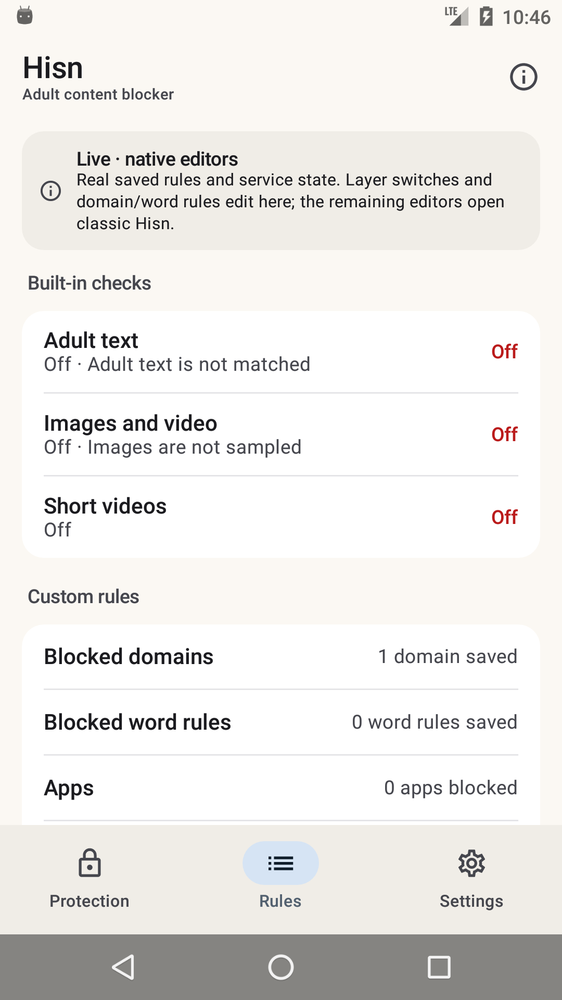
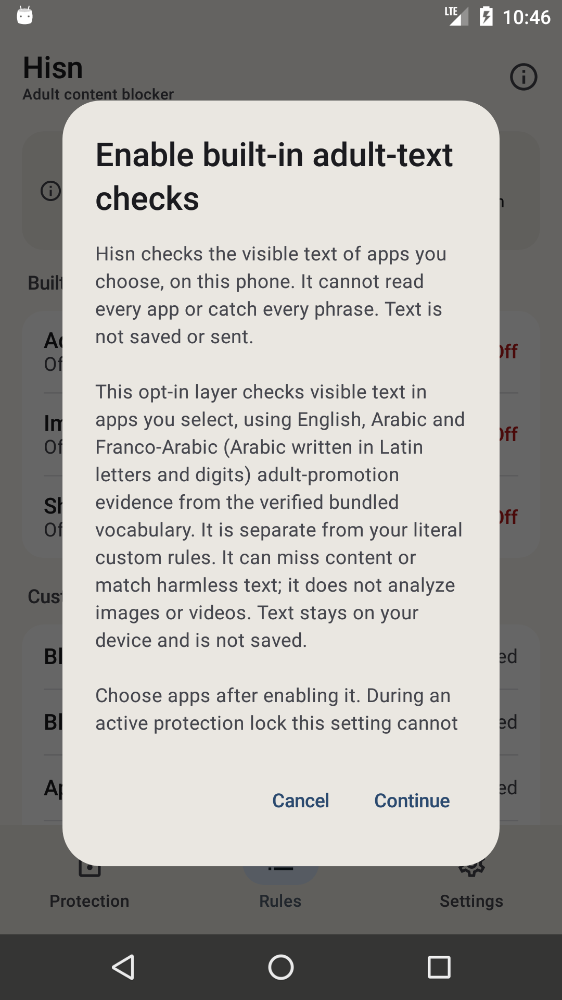

# Android: the native shell, Phase 3

**Status: development, debug-only, 11 November 2026.** The native shell now writes policy for
the layers and rule lists it owns. It is still a second debug launcher: the classic Hisn
launcher remains the default, and DNS start, apps, schedule, limits, the protection lock,
Welcome and Shield still live in the classic screen. Nothing in the native shell is in a
release APK.

Phase 2 moved the shell into the real `app.hisn.android` package and made it read
`PolicyStore`, `DnsVpnService`, `Permissions` and the saved rules. Phase 3 adds the first
native writes, behind the same consent sheets and lock checks as the classic editors.

## What landed

- **Native layer switches.** Adult text, images/video and short videos now open the same
  consent text as the classic layer sheets and save through `PolicyStore.update`,
  `updateVisual` and `updateShortVideo`. Images stays visibly unsupported below Android 14.
- **Native domain and word editors.** The real saved text opens in a native editor; the same
  `RulePreview` canonicalisation reports *N valid · N duplicates · N rejected*; Save writes the
  accepted set through `PolicyStore.update` and keeps every other layer untouched. The exact
  refusal (`rules_editor_private`, `rules_locked`, `rules_invalid`, `rules_save_failed`) is
  shown instead of a generic failure.
- **The protection lock is respected twice.** The editor is read-only and the layer rows show
  the lock notice when `remainingMillis() > 0`; `PolicyStore.save` is the second, authoritative
  check, so a stale UI cannot write through.
- **The editor is private.** The shell adds `FLAG_SECURE` only while the rules editor is open,
  matching the classic dialog. The editor is deliberately absent from screenshots and the
  recent-apps preview; the Rules capture below shows the saved result instead.
- **The consent survives in the banner.** "Live · native editors" now says which surfaces edit
  here and which still open classic Hisn; the old "read-only preview" promise is gone.

## What the shell shows

| Rules after a native save | Native layer consent |
| --- | --- |
|  |  |

The first capture is a real API 23 emulator state: one domain saved by the native editor,
adult text off again after a native disable, images unsupported on API 23, apps/schedule/
limit/lock still owned by classic. The consent sheet is the same short paragraph plus full
disclosure the classic layer buttons show.

## What it does not do yet

- **No DNS start/stop.** The tunnel needs `VpnService.prepare`, the notification permission and
  the existing consent flow; the shell still opens classic for that, and the app has no DNS stop
  API.
- **No native app picker.** After enabling adult text or images with no inspected apps, the
  shell says to choose apps in classic; `AppPicker` is still an `AlertDialog` over the classic
  Activity.
- **No schedule, daily limit, protection lock, uninstall protection, export/import or guardian
  editors.**
- **No Welcome, Shield, Restriction/pause or AfterBlock surfaces.**
- **No Arabic layout, TalkBack, screenshot-test or 2.0× font pass yet.** The host already
  returns Arabic strings, and the consent/editor labels come from `values-ar`.
- **The classic launcher remains the default.**

## Build and run

`-PhisnNativeShell=true` keeps the real application id so the shell can use the installed
policy. Use an emulator/test device, not the owner's release-signed install.

```sh
cd android
export JAVA_HOME="/Applications/Android Studio.app/Contents/jbr/Contents/Home"
export ANDROID_HOME="$HOME/Library/Android/sdk"

./gradlew :app:assembleDebug -PhisnNativeShell=true
adb install -r app/build/outputs/apk/debug/app-debug.apk
adb shell am start -n app.hisn.android/app.hisn.android.nativeshell.ShellActivity
```

Both launchers appear in this variant: **Hisn (classic)** and **Hisn Native**. A plain
`assembleDebug` leaves the shell disabled; `assembleRelease` does not link `:nativeshell` at all.

## Verification, 11 November

- API 23 emulator (`hisn_api23`, minSdk 23): enabled adult text through the native consent,
  verified **On**, disabled it again and verified **Off**; opened the domain editor, saved a
  real rule and verified **1 domain saved**; tapped Images and verified the Android 14+
  message; opened classic from the native action and returned.
- `./gradlew :app:assembleDebug -PhisnNativeShell=true`, `:app:assembleDebug`,
  `assembleDebugAndroidTest`, `lintDebug` and `assembleRelease` pass.
- `android/test-core.sh` and `python3 check-strings.py` pass; the release APK has no
  `nativeshell` or Compose references.

## Next phases

1. **Phase 4a — remaining policy editors.** Native app picker, schedule, time limits,
   protection lock; DNS start with the VPN and notification consent.
2. **Phase 4b — the rest.** Welcome, Shield/Restriction/pause, export/import, Arabic layout,
   TalkBack and screenshot tests.
3. **Parity switch.** Flip the default launcher, keep the classic activity as fallback, then
   remove the classic dashboard from release.
