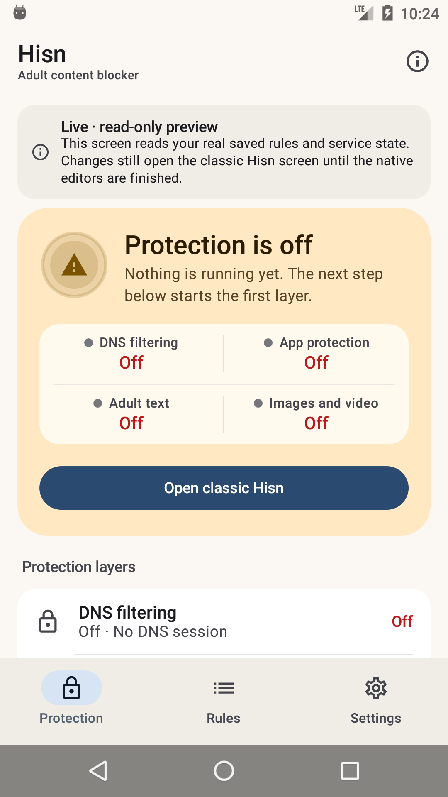
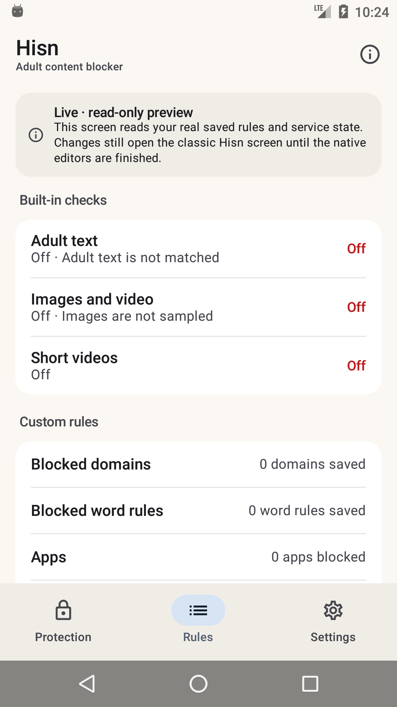
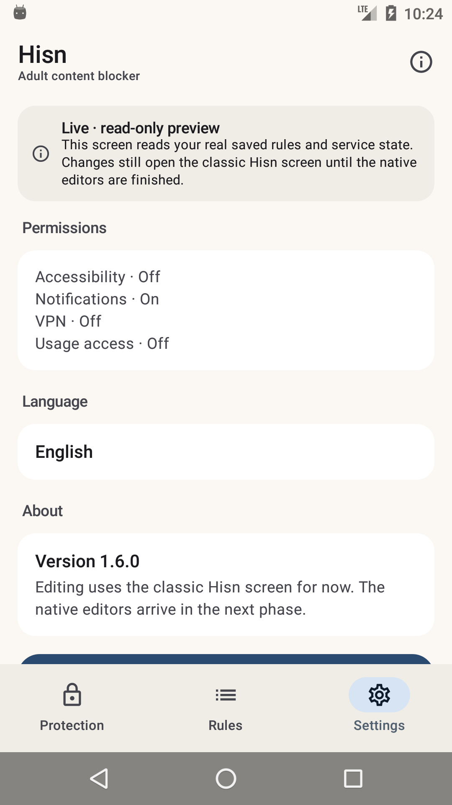

# Android: the native shell, Phase 2

**Status: development, debug-only, 11 November 2026.** The native shell now reads the real
Hisn state in the real `app.hisn.android` package. It is still a **read-only** dashboard:
every editor and every policy write stays in the classic Hisn screen. The classic launcher
remains the default; the shell is a second debug launcher until the native editors reach
parity. Nothing in this phase is in a release APK.

This follows Phase 1, which proved the Compose shell with isolated sample content. Phase 1
could not read `PolicyStore` because it installed under a different package id. Phase 2
removes that isolation: the shell runs in the same process and data directory as the app, so
`PolicyStore`, `DnsVpnService`, `Permissions` and the saved rules are the real ones.

## What landed

- **A host contract, not a copy of the app.** `:nativeshell` defines `NativeShellHost` and a
  `NativeShellBridge`. The debug app installs `LiveShellHost` from a debug-only
  `Application`; the module never sees `:app` classes. That keeps the shell presentation-only
  and lets the release build exclude all of it.
- **Real state.** Protection, the layer ledger, issues, counts, permissions, DNS and
  accessibility status, schedule/time-limit/lock state and the real app version are read from
  the installed app. Strings come from `values/` and `values-ar/` through the host.
- **Real refresh cadence.** The shell polls every two seconds only while resumed, then
  refreshes immediately when you return from a classic editor — the same cadence as the classic
  dashboard.
- **Real route check.** If DNS is running, the primary action calls
  `DnsVpnService.requestConnectionCheck()`; the result arrives as a snackbar. If DNS is not
  running, the primary action opens the classic screen instead of pretending a check can run.
- **Clear read-only affordances.** Layer and rule rows show a state word, not a dead switch;
  the live banner says changes open the classic screen; every issue card has that action.
- **Motion and platform behaviour.** Animated coverage ring, animated status containers, the
  existing shared-axis tab transition, edge-to-edge insets, system dark mode, the navigation
  bar on phones and the rail from 600 dp.

## What the shell shows

| | |
| --- | --- |
| Protection, real empty state | Rules, real counts |
|  |  |



These captures are from a fresh API 23 emulator, so the honest empty state is what a fresh
install sees: **Protection is off**, 0 domains, 0 word rules, 0 apps, VPN/accessibility/usage
off. No number in the shell is a literal. The permissions, version and zero counts are the
same values the classic screen reads from Android and `PolicyStore`.

## What it does not do yet

- **No policy writes.** Adult text, images/video, short videos, domains, words, apps, schedule,
  time limits, the protection lock and uninstall protection are displayed from the store but
  edited in the classic screen. The phase intentionally keeps one writer (`PolicyStore`) and
  one audited UI for the change paths.
- **No DNS start/stop.** Starting the tunnel needs `VpnService.prepare` and the existing consent
  flow; the shell opens the classic screen for that. There is still no DNS stop API in the app.
- **No Welcome, Shield, Restriction/pause, export/import or guardian screens.**
- **No Arabic layout pass yet.** The host returns Arabic strings from `values-ar`, but the shell
  has not been exercised in an Arabic locale on this phase.
- **No TalkBack, screenshot or API 23 motion test** beyond the install and render check.

## Build and run

The shell build deliberately keeps the **same application id** so it can read the installed
policy. It is therefore for an emulator or a test device, not an install over the owner's
release-signed Hisn: a debug build cannot replace a release-signed package, and uninstalling
the release would delete its rules.

```sh
cd android
export JAVA_HOME="/Applications/Android Studio.app/Contents/jbr/Contents/Home"
export ANDROID_HOME="$HOME/Library/Android/sdk"

./gradlew :app:assembleDebug -PhisnNativeShell=true
adb install -r app/build/outputs/apk/debug/app-debug.apk
adb shell am start -n app.hisn.android/app.hisn.android.nativeshell.ShellActivity
```

Both launchers are installed in this variant: **Hisn (classic)** and **Hisn Native**. A plain
`./gradlew :app:assembleDebug` leaves the shell activity disabled and keeps the classic
launcher; `./gradlew :app:assembleRelease` does not link `:nativeshell` at all.

## Verification, 11 November

- API 23 emulator (`hisn_api23`, minSdk 23): installed, launched, rendered Protection, Rules and
  Settings, switched tabs, opened the classic screen from the native action, returned, and
  refreshed real state. No crash.
- `./gradlew :app:assembleDebug -PhisnNativeShell=true`, `:app:assembleDebug` and
  `:app:assembleRelease` pass. The release APK has no `:nativeshell` classes and no Compose
  dependency edge.
- The debug app's `NativeShellDebugApplication` is the only app-side wiring; it does not exist
  in the release variant.

## Next phases

1. **Phase 3 — editors.** Move the native adult-text/images/short-video toggles, domain and word
   editors, app picker and schedule/time-limit/lock dialogs onto `PolicyStore` and the existing
   `RulePreview` validation. Keep every disclosure, consent and lock refusal; no second writer.
2. **Phase 4 — the rest.** Welcome, Shield/Restriction, pause, export/import and Arabic layout,
   then flips the default launcher and removes the classic dashboard from release. The classic
   activity stays as the fallback until the parity checklist passes.
3. **Evidence.** Screenshot tests, TalkBack, API 23 motion, Arabic and large-text passes before
   the launcher switch.
