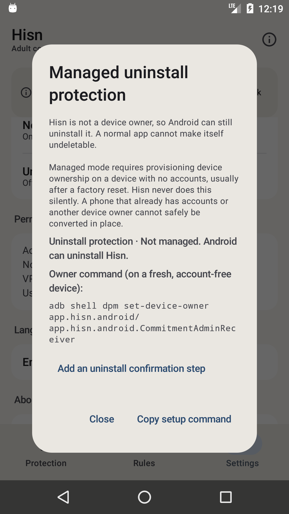

# Android: the native shell, Phase 4g

**Status: development, debug-only, 12 November 2026.** The native Settings screen now opens a
real **uninstall-protection surface**: the platform status, the device-owner provisioning
command with copy, and the device-admin setup screen. The managed switches themselves (keep
installed, lockdown, strict, suspend) still open classic Hisn until they can be exercised on a
device-owner/direct build. The classic launcher remains the default; nothing here is in a release
APK.

## What landed

- **Real platform status.** `UninstallProtectionController.read` supplies the state rendered in
  the sheet: not managed, admin-only, ready, protected (with lock time), out of sync, or an
  error. The Settings row uses a matching On/Off/Attention summary.
- **Provisioning, natively.** When the app is not a device owner, the sheet shows the exact
  `adb shell dpm set-device-owner …` command, selectable and copyable, plus the explanation that
  Android can still uninstall an ordinary app. The command is not invented by the shell.
- **Admin setup.** The native action opens Android's device-admin setup directly.
- **Honest managed boundary.** On a direct build without ownership, or as a device owner, the
  sheet shows the direct/owner disclosure and the real status but says the managed uninstall
  switches still open classic Hisn. It does not pretend an unavailable toggle is native.
- **Settings integration.** The action sits beside the permission shortcuts and SafeSearch, with
  the same live refresh.

## What the shell shows



The capture is a real API 23 unmanaged state: *Not managed. Android can uninstall Hisn*, the
owner command, the copy action and the admin-setup action.

## What it does not do yet

- **No native managed uninstall switches.** Keep-installed, install-only, device-owner lockdown,
  strict restrictions, suspension and release still open classic Hisn. They need a device-owner
  test device before they can be moved safely.
- **No native Welcome, Shield/Restriction/pause or AfterBlock surfaces.**
- **No native export/import or guardian editor.**
- **No Arabic layout, TalkBack, screenshot-test or 2.0× font pass yet.** The host already
  returns Arabic strings.
- **DNS stop** still does not exist in the app.
- **The classic launcher remains the default; the classic UI is not deleted.**

## Build and run

`-PhisnNativeShell=true` uses the real application id so the shell sees installed policy. Use an
emulator/test device.

```sh
cd android
export JAVA_HOME="/Applications/Android Studio.app/Contents/jbr/Contents/Home"
export ANDROID_HOME="$HOME/Library/Android/sdk"

./gradlew :app:assembleDebug -PhisnNativeShell=true
adb install -r app/build/outputs/apk/debug/app-debug.apk
adb shell am start -n app.hisn.android/app.hisn.android.nativeshell.ShellActivity
```

A plain `assembleDebug` leaves the shell disabled; `assembleRelease` does not link
`:nativeshell` at all.

## Verification, 12 November

- API 23 emulator: opened **Settings → Uninstall protection**, saw the real *Not managed* status
  and owner command, tapped **Copy setup command** and verified **Setup command copied.**, opened
  **Add an uninstall confirmation step** (Android device-admin screen) and returned. `pm clear`
  reset the emulator data afterwards.
- `./gradlew --no-daemon assembleDebug assembleDebugAndroidTest lintDebug assembleRelease` pass.
- `./gradlew :app:assembleDebug -PhisnNativeShell=true` passes.
- `android/test-core.sh`, `python3 check-strings.py` and `python3 script/test_docs.py` pass.
- Release APK still has zero `nativeshell`/Compose references.
- Earlier phases re-checked across the stack: layers, apps, schedule, limits, DNS, lock,
  SafeSearch and the classic fallback.

## Next phases

1. **Phase 4h — managed uninstall controls.** Exercise the direct/device-owner path on a
   provisioned test device, then move the keep/install/lockdown/strict/suspend switches and
   release flow into the native sheet.
2. **Phase 5 — remaining surfaces.** Welcome, Shield/Restriction/pause, export/import, Arabic,
   TalkBack and screenshot tests; then flip the launcher and remove the classic dashboard.
