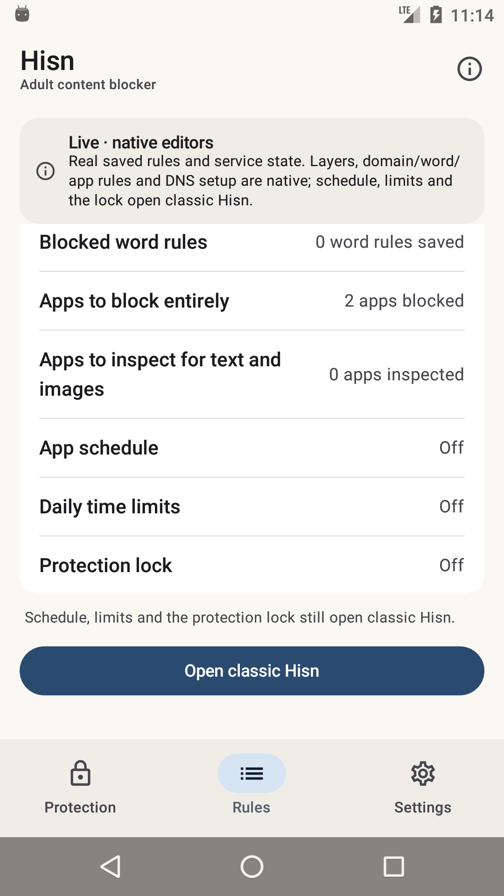

# Android: the native shell, Phase 4b

**Status: development, debug-only, 11 November 2026.** The native shell can now choose the
blocked and inspected apps through a native picker, in addition to the layer switches,
domain/word rules and DNS setup landed in the earlier phases. The classic launcher remains the
default; schedule, time limits, the protection lock, Welcome and Shield are still classic.
Nothing here is in a release APK.

## What landed

Phase 2 made the shell read real state. Phase 3 added native layer switches and the domain/word
editor. Phase 4a added native DNS setup. Phase 4b adds the app selection:

- **Native blocked-app picker.** "Apps to block entirely" opens a native picker over the phone's
  own launchable apps, with the real saved selection, search over label or package name, app
  icons, a live selected count, and the 200-app limit. Save writes through `PolicyStore.update`.
- **Native inspected-app picker.** "Apps to inspect for text and images" uses the same picker
  and writes `scannedApps`. The adult-text and image layer consent then has selected apps to
  work with, instead of sending the owner back to classic.
- **Saved packages survive.** The classic picker keeps packages that are temporarily uninstalled.
  The native save merges the visible selection with those saved-not-installed packages instead of
  dropping them.
- **The protection lock is enforced.** The picker is read-only and Save is disabled while a lock
  runs; `PolicyStore.save` is the authoritative second check. Refusal text is exact.
- **The list is private.** `FLAG_SECURE` is set while the picker is open, matching the classic
  dialog; it is deliberately absent from screenshots and the recent-apps preview.
- **Keyboard discipline.** The dialog window focused the search field on API 23 and covered Save.
  The picker now moves focus to the list; the keyboard opens only when the owner taps search.
- The Rules note and banner now say schedule, limits and the lock — not apps — still open classic.

## What the shell shows



The capture is a real API 23 emulator state: **2 apps blocked**, **0 apps inspected**, one domain
from the Phase 3 editor, DNS configured in Phase 4a, and the remaining classic editors named.
The picker itself cannot be captured because it carries `FLAG_SECURE`; the saved result is the
evidence.

## What it does not do yet

- **No schedule, daily limit or protection-lock editors.** They still open classic.
- **No uninstall protection, export/import or guardian editors.**
- **No Welcome, Shield/Restriction/pause or AfterBlock surfaces.**
- **No Arabic layout, TalkBack, screenshot-test or 2.0× font pass yet.** The host already
  returns Arabic strings.
- **DNS stop** still does not exist in the app; Android VPN settings/revoke remains the way out.
- **The classic launcher remains the default; the classic UI is not deleted.**

## Build and run

`-PhisnNativeShell=true` uses the real application id so the shell sees installed policy. Use an
emulator/test device, not the owner's release-signed install.

```sh
cd android
export JAVA_HOME="/Applications/Android Studio.app/Contents/jbr/Contents/Home"
export ANDROID_HOME="$HOME/Library/Android/sdk"

./gradlew :app:assembleDebug -PhisnNativeShell=true
adb install -r app/build/outputs/apk/debug/app-debug.apk
adb shell am start -n app.hisn.android/app.hisn.android.nativeshell.ShellActivity
```

A plain `assembleDebug` leaves the shell disabled; `assembleRelease` does not link
`:nativeshell` at all.

## Verification, 11 November

- API 23 emulator: opened **Apps to block entirely**, searched/selected **Browser** and
  **Calendar**, saved, and verified **2 apps blocked** in Rules; the inspected picker opened with
  the same list and **0 apps inspected** preserved. Picker focus no longer raises the keyboard;
  icons and package names render; the list stays private (`screencap` is blank while open by
  design).
- Phase 3 and 4a flows re-checked: adult enable/disable, one saved domain, Android 14+ image
  message, native DNS setup to **DNS On / Partly protected**, open classic/back.
- `./gradlew --no-daemon assembleDebug assembleDebugAndroidTest lintDebug assembleRelease` pass.
- `./gradlew :app:assembleDebug -PhisnNativeShell=true` passes.
- `android/test-core.sh`, `python3 check-strings.py` and `python3 script/test_docs.py` pass.
- Release APK still has zero `nativeshell`/Compose references.

## Next phases

1. **Phase 4c — schedule, time limits, protection lock.** Native editors for all three, with the
   lock's read-only consequences and the existing schedule/limit/lock text.
2. **Phase 5 — remaining surfaces.** Welcome, Shield/Restriction/pause, export/import, Arabic,
   TalkBack and screenshot tests; then flip the launcher and remove the classic dashboard.
