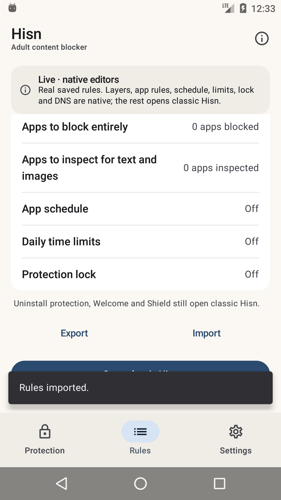

# Android: the native shell, Phase 4h

**Status: development, debug-only, 12 November 2026.** The native Rules screen can **export and
import** the canonical `RuleDocument` through Android's system file picker. The managed uninstall
switches, Welcome, Shield and the remaining surfaces are still classic; the classic launcher
remains the default and nothing here is in a release APK.

## What landed

- **Real document format.** Export writes `RuleDocument.export(domainText, wordText)` — the same
  JSON schema/version/platform fields, canonicalised through `RulePreview`, that the classic
  Rules file action writes. Import reads through the same `HostListStore` bound and
  `RuleDocument.parse` validation.
- **System file picker.** `ActivityResultContracts.CreateDocument` / `OpenDocument` replace the
  classic activity-result plumbing; no path, permission or storage implementation is invented by
  the shell.
- **Confirmation before merge.** The import preview reuses the real counts:
  *Adds N sites and N word rules*, skipped entries, and any unsupported browser/platform fields.
  Apply performs the add-only `RuleDocument.merge` and the ordinary `PolicyStore.update`, keeping
  apps and layers untouched; Cancel discards the pending parse.
- **Exact refusals.** A protection lock refuses import before any file is read; oversized,
  unreadable or non-Hisn documents show the existing exact messages; export failures show
  *The file could not be written.*
- **Native controls.** Export and Import sit under the Rules list beside the existing native
  editors, with the same Material 3 surface and snackbar feedback.

## What the shell shows



The capture is the real API 23 result after exporting a one-domain document to Downloads and
importing it again: **Rules imported.** The system picker and confirmation are intentionally not
reproduced as native chrome; they are Android's own surfaces.

## What it does not do yet

- **No native managed uninstall switches**; the status/provisioning sheet remains, and managed
  toggles still open classic.
- **No native Welcome, Shield/Restriction/pause or AfterBlock surfaces.**
- **No native guardian/export of the full policy** (only the two rule lists, matching classic).
- **No Arabic layout, TalkBack, screenshot-test or 2.0× font pass yet.**
- **DNS stop** still does not exist in the app.
- **The classic launcher remains the default; the classic UI is not deleted.**

## Build and run

`-PhisnNativeShell=true` uses the real application id so the shell sees installed policy.

```sh
cd android
export JAVA_HOME="/Applications/Android Studio.app/Contents/jbr/Contents/Home"
export ANDROID_HOME="$HOME/Library/Android/sdk"

./gradlew :app:assembleDebug -PhisnNativeShell=true
adb install -r app/build/outputs/apk/debug/app-debug.apk
adb shell am start -n app.hisn.android/app.hisn.android.nativeshell.ShellActivity
```

## Verification, 12 November

- API 23 emulator: added **example.org** through the native domain editor, exported via
  CreateDocument into Downloads, verified *Rules exported.*, imported the same file via
  OpenDocument, verified the *Adds 1 sites and 0 word rules* confirmation, applied it, and saw
  *Rules imported.* `pm clear` reset the emulator data.
- `./gradlew --no-daemon assembleDebug assembleDebugAndroidTest lintDebug assembleRelease` pass.
- `./gradlew :app:assembleDebug -PhisnNativeShell=true` passes.
- `android/test-core.sh`, `python3 check-strings.py` and `python3 script/test_docs.py` pass.
- Release APK still has zero `nativeshell`/Compose references.
- Earlier phases re-checked across the stack: layers, apps, schedule, limits, DNS, lock,
  SafeSearch, uninstall status and the classic fallback.

## Next phases

1. **Phase 4i — managed uninstall controls** on a provisioned device-owner/direct test device.
2. **Phase 5 — remaining surfaces.** Welcome, Shield/Restriction/pause, full policy export,
   Arabic, TalkBack and screenshot tests; then flip the launcher and remove the classic
   dashboard.
