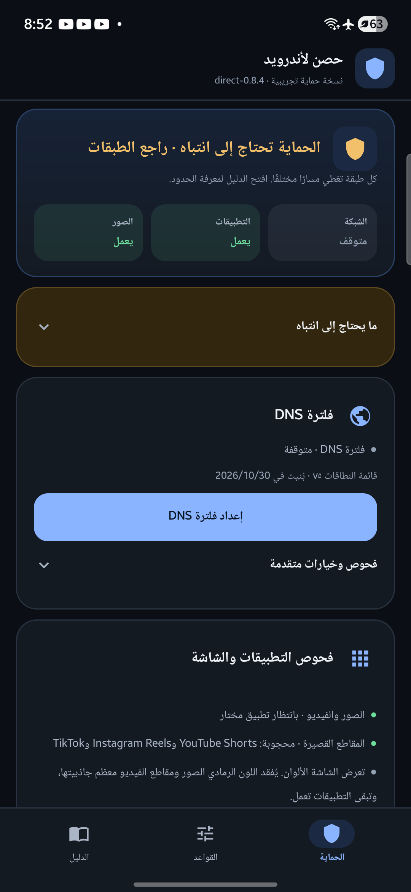
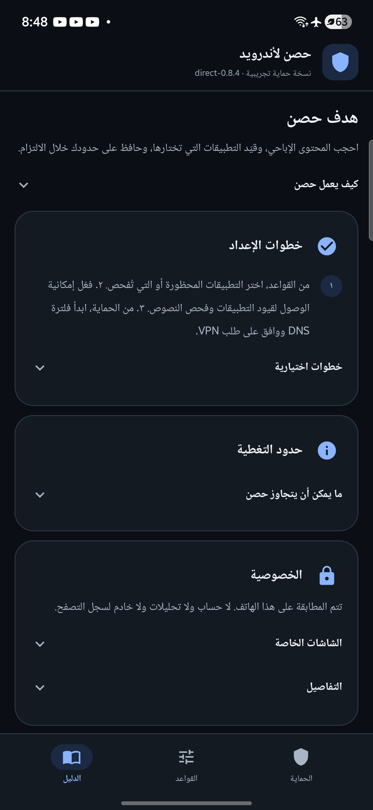

# UI principles and the 2026-11-02 pass

Sources consulted:

- [Progressive Disclosure — Nielsen Norman Group](https://www.nngroup.com/articles/progressive-disclosure/)
- [Defer Secondary Content When Writing for Mobile Users — Nielsen Norman Group](https://www.nngroup.com/articles/defer-secondary-content-for-mobile/)
- [Applying type — Material Design 3](https://m3.material.io/styles/typography/applying-type)

## What the app applies

- **One primary action per card.** DNS has one start/setup button; advanced
  checks sit behind a disclosure.
- **Progressive disclosure.** Attention details, advanced DNS checks, full guide
  steps, limits, privacy detail and uninstall explanations are collapsed until
  requested. Their headers use a full 48 dp touch target and a chevron.
- **Defer secondary mobile content.** The first Protection screen is now status,
  three layer tiles, the count-free attention disclosure, the DNS action and app
  checks. Long explanations moved to Guide.
- **Short primary copy.** The goal is one sentence; details are under “How Hisn
  works”. The seed line is one line.
- **Remove duplicates.** When the next setup step is “start DNS”, the separate
  recommendation card is hidden because the DNS card already owns that action.
- **RTL and Arabic.** All new strings have Arabic equivalents and follow the
  existing RTL layout; disclosure descriptions are localized.
- **State first, explanation second.** The three layer tiles remain the fastest
  read; the status sentence is one short line, not a paragraph.

## What changed in this pass

- Attention card: a single disclosure titled “Needs attention”, collapsed by
  default, instead of a bullet wall on the main screen.
- DNS card: SafeSearch, VPN settings, route check and watchdog moved into
  “Advanced checks and options”; private-DNS bypass expands it automatically.
- Guide: one-sentence goal; three core setup steps; optional steps, limits,
  privacy detail and uninstall detail behind disclosures.
- Duplicate “Recommended setup” DNS card hidden on the DNS step.
- Status paragraph replaced with a one-line caption.
- Seed/version line shortened.

## Not claimed

These are heuristic improvements, not measured usability results. No user
testing, accessibility audit or screen-reader pass was run for this change.
